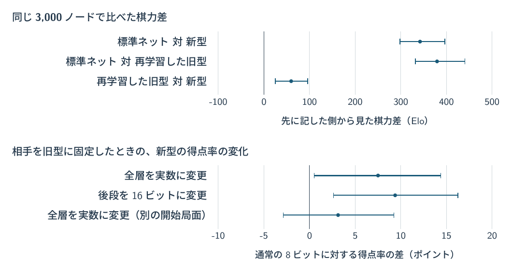

# tatara方式に変更したP型評価関数の棋力低下

2026年11月19日、P型評価関数に将棋の先行実装tataraの構造（LayerStack）を採用した際に棋力が低下した原因を調べた。教師データ、学習期間、推論時の量子化、探索時の手の順序を比較した。
前日の短時間対局では、変更前のP型が変更後のP型を64.4 Elo上回った（95%信頼区間37.2〜92.4 Elo）。
比較したのは、分岐時のmaster `a48f03aa` と変更後の `8b853b66` で、同じ教師からそれぞれ学習した重みを使っている。
P型は駒種と升を入力とする差分更新型ニューラルネットワーク（NNUE）である。以下では移行前のP型を旧型、LayerStackを採用したP型を新型と呼ぶ。新型は、盤上の特徴を加算した後に要素積をとり、幅16、幅32の層を経て得点を求める。幅16のうち1個の出力は後の層を通さず最終得点に加算する。別に、駒数で補間しない1列の駒種・升別の点数表（PSQT）を持ち、両視点の差を加える。旧型の点数表は序中盤用と終盤用の2列を駒数に応じて補間する。両型とも実数で学習し、対局用には係数を整数化する。[対局記録](../measurements/nnue-tatara-framework-and-halfkp-vm/nnue-tatara-framework-and-halfkp-vm-stc.md)

別の教師から以前に学習したmasterの標準ネットは、1手3,000ノードで新型に342.0 Elo勝った。大差の原因として直接確認できたのは、学習に使った教師と、過学習した最終版を採用したことである。新型は同じデータで約2.07エポックまで学んだ時点で、約66.3エポックの最終版を153.4 Elo上回っていた。教師の出所だけを変えた縮小実験でも、標準ネットと同じ教師から学んだ側が2つのシードで61.4 Elo、164.1 Elo勝った。[学習期間の比較](../measurements/adhoc/tatara-p-early-new-vs-new.md)・[教師を変えた対局（シード1）](../measurements/adhoc/tatara-p-corpus-1.md)・[同じ比較のシード2](../measurements/adhoc/tatara-p-corpus-2.md)

元の64.4 Elo差は、同じ教師で学んだ旧型と新型の差である。新旧を同じ時点で打ち切っても、旧型の優位は残った。新型は整数化前から終盤の教師勝率と元の対局の勝敗を旧型ほど正確に予測できず、整数化でさらに不利になった。相手を旧型に固定した400ペアでは、新型の得点率は全層を実数にすると平均5.31ポイント上がった。通常の新型との直接対局では実数版の優位は見られず、整数化の影響は対戦相手に依存した。これらの効果を加算して元のElo差へ割り振ることはできない。[同じ時点で打ち切った新旧の対局](../measurements/adhoc/tatara-p-early-old-vs-early-new.md)・[通常の新型に対する実数版の対局](../measurements/adhoc/tatara-p-float-new-3000.md)

図の点は直接対局の推定値、横線は95%信頼区間を表す。下段は同一の開始局面で先後を入れ替え、旧型を相手とする新型の得点率が通常の8ビットから何ポイント変わったかを示す。

## 比較相手によって棋力差の意味が変わる

分岐時のmasterは、評価関数の重みを外部ファイルから読み込む。普段の探索測定に使う標準ネットの重みは11月4日に学習した `987f060d…` で、11月18日の対局に出た旧型は `fc86cce6…` である。前者は30ファイルの教師を使い、後者と新型 `37054c9e…` は、第2世代の同じ37ファイルから学んだ。以下の固定ノード対局では各エンジンに1手3,000ノードを与えた。この条件では実時間あたりに評価できる局面数に差があっても、探索できるノード数は等しい。[標準ネットの学習](../measurements/nnue-architecture-revision/nnue-architecture-revision-init-training.md)

| 固定ノード対局の候補 | 相手 | 有効ペア | 候補の棋力差と95%信頼区間 |
|---|---|---:|---:|
| masterの標準ネット | 新型 | 200 | [+342.0 Elo［+298.2, +396.3］](../measurements/adhoc/tatara-p-standard-master-vs-new.md) |
| masterの標準ネット | 同じ教師で学び直した旧型 | 200 | [+379.3 Elo［+331.8, +440.2］](../measurements/adhoc/tatara-p-standard-master-vs-retrained.md) |
| 同じ教師で学び直した旧型 | 新型 | 200 | [+59.6 Elo［+24.8, +95.8］](../measurements/adhoc/tatara-p-old-3000.md) |
| 第2世代の教師で以前に学んだ旧型 | 同じ教師で学び直した旧型 | 200 | [+168.4 Elo［+133.9, +206.3］](../measurements/adhoc/tatara-p-gen2-old.md) |

2026年11月19日現在のmaster `bf6c1dd5` と分岐時の `a48f03aa` は、対局に使う探索と評価の実装が同じだった。標準ネットと学び直した旧型の対局では、両側が同じ実行ファイルを使った。表の各行は直接対戦の推定値である。対戦相手への相性、開始局面、標本誤差があるので、各行のEloを足したり引いたりして損失を配分することはできない。同じ最終重みどうしの固定ノード対局を別の開始局面でも2回行った。3組を合計した600有効ペアで旧型の得点率は56.50%、ペアの得点度数をまとめた差は+45.4 Elo（95%信頼区間+26.3〜+64.9）だった。短時間対局と固定ノード対局の両方で旧型の優位が見えたことから、推論速度だけでは載せ替え後の弱化を説明できない。[2組目の固定ノード対局](../measurements/adhoc/tatara-p-old-new-repeat.md)・[3組目の固定ノード対局](../measurements/adhoc/tatara-p-final-old-vs-new.md)

第2世代の教師には、同じ旧型で当時学んだ補正前の重み `08b408d9…` が残っている。当時は二値交差エントロピーで学習し、検証損失が最小になった2エポック目を採った。今回の学び直しは勝率の二乗誤差を使い、約66.3エポック目を採った。学習率スケジュール、重み減衰、教師値を勝率へ換算する尺度も異なる。教師の版変換は全37ファイルについて、規定された版番号とフラグのビット配置を変えればバイト単位で一致した。275,798局、127,616,371項目の指し手、評価値、終局結果は同じだった。したがって、この直接対戦で見えた差は、教師の対局内容を変更しなくても旧型の学習条件を変えることで生じる。[第2世代の学習条件](../measurements/nnue-generation-reset/nnue-generation-reset-gen2-training.md)

この学習では6,104更新を1 superbatchとする。同じ37ファイルと64 superbatch用の学習率スケジュールを保ち、2回目のsuperbatchで書き出した旧型を最終版と直接比較した。約2.07エポックの旧型は約66.3エポックの旧型を+128.0 Elo上回った（200ペア、95%信頼区間+93.9〜+164.6）。先頭2回の訓練損失も元の学習ログと一致した。新型でも同じ比較で2回目のモデルが最終版を+153.4 Elo上回った（200ペア、95%信頼区間+120.5〜+189.2）。両型とも長く学習したときは、検証損失と実戦の棋力がともに悪化した。[全教師で新型の学習期間を変えた対局](../measurements/adhoc/tatara-p-early-new-vs-new.md)・[全教師で旧型の学習期間を変えた対局](../measurements/adhoc/tatara-p-early-old-vs-old.md)

標準ネットを相手に同じ200開始局面で比べると、新型の得点率は最終版の12.25%から2回目の27.38%に上がった。開始局面単位で測った改善幅は+15.13ポイント（95%信頼区間+10.00〜+20.25）だった。それでも標準ネットは2回目の新型に+169.5 Elo（+133.9〜+208.7）勝った。早期に打ち切ると標準ネットとの差は縮まるが、差はなお大きい。[標準ネットと学習初期の新型](../measurements/adhoc/tatara-p-standard-vs-early-new.md)

同じ教師から抽出した60,000局面では、教師の探索値を旧型と同じ尺度で勝率へ変換したとき、標準ネットの二乗誤差は0.011252、以前の旧型は0.001141、学び直した旧型は0.001336、新型は0.001454だった。標準ネットは教師の探索値から最も離れ、直接対局には勝った。この教師の検証損失を最小にすることと、実戦で標準ネットを超えることは異なる目標である。教師を生成したエンジンは標準ネットの系列では `31c2a46`、第2世代では `7c2cfe4e` だった。旧型の学習器に渡す `--base` は47種類の探索用駒価値と勝率尺度、規則を読む。以前のネットで学習済みの非線形層から再開する指定ではない。[30ファイルの生成](../measurements/nnue-lr-schedule/nnue-lr-schedule-training.md)・[第2世代の教師と学習条件](../measurements/nnue-generation-reset/nnue-generation-reset-gen2-training.md)

## 棋譜では序盤の駒得と勝敗が一致しない

元の短時間対局は、並列実行の終了までに296ペアを書き出した。判定に使ったのは第284ペアまでで、手数上限に達した3ペアを除く281ペアである。旧型は先手で168勝105敗8分、後手で155勝115敗11分だった。1局平均の思考時間は旧型26.68秒、新型27.39秒で、開始局面後の最初の32手の平均完了深さはそれぞれ18.49手、17.49手だった。

開始局面から96手後まで両局が続いた276ペアでは、新型が手書き評価v0の駒価値で平均79.0センチポーン（cp）駒得していた。対局ペアを単位とする95%信頼区間は58.3〜100.2 cpだった。新型の歩兵が平均0.578枚、仲人が0.130枚多く、この2駒種で74.1 cpに相当した。獅子と奔王の枚数はほぼ同じだった。96手後に新型が駒得していた327局に限っても、旧型の得点率は54.9%だった。序盤に大駒を失うために新型が負けたという説明は、棋譜に現れた差と合わない。

同じ70ペアから各1局面を取り出し、96手後の歩兵を1枚ずつ除いて得点の変化を持ち主の側から読むと、旧型36.01 cp、新型40.10 cpだった。取得した歩兵の多さと評価の方向は一致するが、この差だけを勝敗の原因とすることはできない。別の210局面で6,000ノード探索が選んだ手が新旧で一致したのは64局面だった。標準ネットに各着手後36,000ノードを与えた判定では、旧型の選んだ手の平均優位は+0.87 cpで、開始局面ペア単位の95%信頼区間は−14.30〜+16.27 cpだった。個々の着手の価値を決めるには、この探索値にも不確かさがある。

## 駒数によって評価誤差の原因が異なる

検証集合の全5,162,867局面で、教師の探索値と評価関数の出力をそれぞれ手番側の勝率に換算し、その差の二乗を平均した。
対局用の整数評価では、旧型の損失は0.00141129、新型は0.00147616で、差は64.87×10⁻⁶だった。
実数の重みで同じ局面を評価した時点で差は32.04×10⁻⁶あり、両型を整数化すると差がさらに32.83×10⁻⁶広がった。
対局単位の95%信頼区間は、順に42.77〜89.62、10.17〜56.11、31.56〜34.10（単位はいずれも10⁻⁶）だった。
量子化が占める50.6%という割合は、この2本の重みの検証損失差について計算した値である。同じ重みのまま推論の精度を変えた対局では、棋力への影響は相手によって異なった。

盤上に76〜92枚の駒が残る局面では、実数評価における両型の損失差は−0.09×10⁻⁶にとどまり、整数評価で40.03×10⁻⁶に広がった。
新型はこの局面群で教師の探索値を手番側に平均0.23 cp高く評価していたが、整数化すると偏りが+16.01 cpになった。旧型の整数評価の偏りは+1.08 cpだった。
一方、2〜25枚の局面では、新型の勝率の損失は整数化する前から旧型より80.72×10⁻⁶大きかった。
この局面群では、教師とのcpの平均絶対差は新型のほうが小さい。勝率への変換が互角に近い局面の誤差を重く評価するため、両指標の順位は一致しない。

| 駒数 | 検証局面数 | 実数の損失差と95%信頼区間 | 整数の損失差と95%信頼区間 | 教師に対する平均絶対差（旧型整数／新型整数、cp） |
|---|---:|---:|---:|---:|
| 2〜25枚 | 1,214,936 | +80.72［+3.66, +163.52］ | +108.40［+32.94, +191.49］ | 219.33／218.52 |
| 26〜50枚 | 1,145,560 | +54.27［−4.47, +111.67］ | +92.99［+32.90, +150.25］ | 129.90／133.58 |
| 51〜75枚 | 1,116,164 | +4.77［−0.59, +9.89］ | +26.14［+20.67, +31.31］ | 45.40／47.59 |
| 76〜92枚 | 1,686,207 | −0.09［−0.57, +0.43］ | +40.03［+39.35, +40.76］ | 22.37／27.70 |
| 全体 | 5,162,867 | +32.04［+10.17, +56.11］ | +64.87［+42.77, +89.62］ | 97.56／100.40 |

損失差は新型から旧型を引いた値を10⁶倍したものである。
駒数による分類は調査中に選んだもので、区間に多重比較の補正は施していない。
26〜50枚では新型の実数評価における損失が大きいものの、対局単位の区間は0を含む。

## 後段の最初の2層で偏りが生じる

整数化の影響を調べるため、新型の最終チェックポイントの実数評価を基準とし、1層ずつ重みとバイアスを量子化した。
幅16の層だけで平均+5.52 cp、幅32の層だけで+3.66 cpの偏りが生じた。
両層のいずれを単独で整数化しても同じ向きに偏るため、新型の整数評価は手番側に寄りやすい。
誤差は同じ局面の各層で相関し、後続の活性化関数も非線形なので、行ごとの誤差は加算できない。[新型の実数評価](../../crates/minase-trainer/src/nnue/layerstack/reference.rs)・[重みの量子化](../../crates/minase-trainer/src/nnue/layerstack/export.rs)・[整数推論](../../crates/minase/src/eval/nnue/network/layer_stack.rs)

| 整数化した部分 | 平均誤差（cp） | 平均絶対誤差（cp） |
|---|---:|---:|
| 入力特徴を加算する第1層の重みとバイアス | +0.03 | 4.91 |
| 第1層と直後の要素積 | +0.07 | 5.30 |
| 後段の幅16の層の重みとバイアス | +5.52 | 9.42 |
| 後段の幅32の層の重みとバイアス | +3.66 | 6.04 |
| 後段の出力層の重みとバイアス | −0.57 | 1.04 |
| 全体を対局用の8ビット後段で整数化 | +9.88 | 14.22 |
| 全体を16ビット後段で整数化 | +0.25 | 5.84 |

後段を16ビットにすると新型の評価は同じ重みの実数評価に近づくが、旧型の平均絶対量子化誤差3.47 cpを上回る。
層別の量子化を再計算した60,000局面で教師に対する勝率の損失は、旧型の整数評価が0.0013364、新型の整数評価が0.0014540、新型の後段を16ビットにした場合が0.0014282だった。
後段を16ビットにするとこの損失は小さくなった。通常の新型に対して、対局で得点率が上がるかどうかは別に検証した。

## 8ビットのまま丸めの偏りを減らす実験

整数の桁数による制約と、個々の重みを独立に最近接の整数へ丸める方法の影響を区別するため、8ビットの形式と整数推論を保ったまま、新型の書き出しだけを変更した。
訓練集合96,462,343局面からシード1329で32,768局面を一様に重複なく抽出し、整数評価を学習済み新型の実数評価に近づけた。
まず、各層の活性化前の値の平均が実数と整数で合うように、幅16と幅32の層のバイアスを補正した。
次に、出力に直接つながる幅16の層の最終行と出力層の計288係数について、各実数係数を挟む2つの整数から、出力の二乗誤差を小さくするほうを順に選んだ。
8巡目で選択が変わらなくなり、34係数で丸めの向きが元の書き出しと異なった。
出力バイアスも訓練標本での平均誤差から求めた。
この処理に教師の探索値や検証集合は使っていない。

変更後のファイルを対局用のエンジンで読み、検証標本60,000局面の整数評価が診断用の計算と全件一致することを確かめた。
実数評価に対する手番側の平均誤差は+9.88 cpから+0.18 cpに、平均絶対誤差は14.22 cpから9.21 cpに減った。
教師に対する勝率の損失も0.0014540から0.0014300に減少した。
76〜92枚の局面で教師に対する平均誤差は+15.58 cpから+0.39 cpとなり、平均絶対差は27.55 cpから23.60 cpまで縮小した。
平均の偏りの大部分は同じ整数形式のまま除ける一方、個々の局面の誤差は16ビット後段の5.84 cpより大きい。
検証集合全体でも、補正により整数評価の損失は0.00147616から0.00145212に減った。減少幅は24.04×10⁻⁶（95%信頼区間23.21〜24.97×10⁻⁶）で、旧型に対する損失差の37.1%に当たる。
補正したファイルは再計算用ディレクトリ `training/` の `p-calibrated.bin`、作成手順は `prepare_calibration.py` と `calibrate.py` にあり、ファイルのSHA-256は `8843a93ea994d32622cee02f7c044aa6793e128608c7936fe274bcd3ad453047` である。

## 実数の学習にも差が残る

検証集合全5,162,867局面を使った学習ログでは、8回目のsuperbatchで旧型の損失が0.0012590、新型が0.0012973だった。
64回目には旧型が0.0014149、新型が0.0014470に悪化したものの、両型の差は38.3×10⁻⁶から32.0×10⁻⁶へむしろ縮まった。
学習の最終時点の重みを採ったために新型だけが過学習したという説明は、この学習曲線に合わない。
幅16の層の重みの上限を緩くした先行試行でも、8回目の新型の損失は同じで、64回目も0.0014506だった。[学習条件と検証曲線](../measurements/nnue-tatara-framework-and-halfkp-vm/nnue-tatara-framework-and-halfkp-vm-training.md)

新型のPSQTの各係数は、初期の駒価値から絶対値の平均で36.40 cp動いた。
旧型の線形部分の移動量は序中盤用の係数で2.50 cp、終盤用の係数で2.98 cpだった。
そこで、学習済み新型の非線形部分を固定し、同じ60,000局面に対してPSQTの得点だけを旧型の線形部分の得点に差し替えた。
教師に対する実数の勝率損失は0.0014252から0.0018786に増えた。
両部分を足して学習した重みの片方だけを交換すると、もう片方が学んだ補正との組み合わせも変わる。
そこでPSQTの学習率だけを下げ、非線形部分も含めて学び直した。[初期化と学習率を変えた対局](#初期化と学習率を変えた対局)

同じ重みに対し、駒数に応じて補間する表を残差に当てはめる実験も行った。訓練標本で係数を当てはめ、正則化の選択に使った対局を除く4,140局、78,894局面で評価した。正則化係数10,000で、駒数によらない表に対する二乗誤差の差は+0.11×10⁻⁶（95%信頼区間−0.05〜+0.26×10⁻⁶）だった。学習済みの新型に補間を後から加えるだけで弱点を取り除けるという証拠は得られなかった。学習開始時から補間を組み込む場合には、非線形部分も異なる重みを学びうる。

## 学習開始時に幅32の層の一部が更新されなくなった

学習済みの新型では、幅32の隠れ層の12ユニットが検証集合の全5,162,867局面で0を出力した。旧型で同じ条件に該当したのは2ユニットだった。
この層は、入力の加重和にバイアスを足した値が0以下なら、出力も勾配も0になる。
新型の12ユニットのうち2個では、バイアスに正の重みをすべて足しても負になる。入力は0以上1以下なので、この2個はどの局面でも0を出力する。
残る10個について確認できたのは検証集合での出力である。

新型の学習開始時の現象は、元の学習の最初の2バッチを使って再現できた。
訓練局面の通し番号96,462,343件のSHA-256が学習時の記録と一致することを確かめ、学習器がシード1で作る最初のエポックの順列から先頭32,768件を復元した。
学習済みの重みを使わず、元の学習と同じ初期重みからCPU上の参照実装で16,384局面ずつ2回更新した。
各更新の前後に、訓練に用いなかった検証集合から選んだ10,000局面で各ユニットの出力を測った。

学習前には32個すべてが少なくとも1局面で正の値を出した。
ただし、バイアスはすべて0で、活性化関数に入る値の局面間最大値は、ユニット別に見て約0.000002〜0.000009しかなかった。
1回目の更新でバイアスが約±0.001動くと、14個は検証標本の全局面で出力が0になり、2回目の更新に使う訓練バッチでもその14個すべてでバイアスの勾配が0になった。
2回目の更新後は17個が検証標本の全局面で0となった。
最終モデルで0だった12個のうち、6個は1回目の更新直後、8個は2回目の更新直後にも0だった。
最初に応答を失ったユニットの一部は、その後の学習で回復したことになる。

同じ初期重み、教師局面、更新条件を使い、幅32の層の初期バイアスだけを+0.05にすると、2回の更新後も32個すべてが正の応答を保った。
この比較から、元の設定ではバイアスの初回更新量が活性化前の値よりも大きいため、複数のユニットで更新直後から勾配が0になることが分かる。
これを防ぐと棋力が上がるかは、バイアスを変えて学習したモデルの対局で測る必要がある。
原記録は再計算用ディレクトリ `inference/` の `full-activity.log`、`first-original.log`、`replay-original/`、`replay-positive005/` にある。

全37ファイルで12,208回の更新まで再学習した新型では、固定した10,000局面のどこでも応答しない12個の番号が、最終版の全検証局面で応答しなかった12個と一致した。

この組み合わせには参考実装との差もある。tataraの `87f1955` では、既定の最適化器Rangerが学習の最初に使うRAdamの更新は、勾配の二乗平均で正規化しない。minaseはtataraの層構造と初期値を取り入れ、最適化器には引き続きAdamWを使った。勾配が小さくても初回に約0.001の更新が起きたのは、このminaseでの組み合わせについての観測である。Rangerへの変更そのものの棋力は今回測っていない。[設計時に選んだ学習条件](../plans/archived/nnue-tatara-framework-and-halfkp-vm.md)

## 新旧の評価は整数化前から実戦の指し手を異なる順に並べた

元の対局の判定に使った281ペアから、11手ごとに計20,766局面を取り出した。
旧型と新型の実数評価の絶対差は平均285.95 cpであり、各モデルの整数評価と自身の実数評価との平均絶対差は、旧型4.99 cp、新型16.96 cpだった。
線形経路どうしの差は平均77.08 cp、非線形経路どうしの差は308.40 cpで、2経路の差は一部の局面で相殺した。

このうち337局面で各着手後の全31,064局面を評価すると、旧型と新型の実数評価では、最善とみなす手が35.3%の局面で異なった。
新型の整数評価を自身の実数評価と比べると、この割合は9.8%で、後段を16ビットにすると6.8%へ下がった。
同じ親局面の着手対のうち、基準となる実数評価で差が0.1 cpを超えるものに限ると、厳密な順序が逆になった割合は新旧の実数評価間で26.8%、新型の実数と整数の間で4.0%、後段を16ビットにした新型の実数と整数の間で2.3%だった。
これらは着手直後の静的評価に基づく順位である。

20,766局面で静的評価から手番側の得点を予測し、実際の終局結果との二乗誤差を比べた。
予測には教師と同じ尺度679.029296875 cpを使い、終局得点は勝ち1、引き分け0.5、負け0とした。
平均二乗誤差は旧型実数で0.181560、新型実数で0.187325、新型整数で0.187695だった。
新型実数と旧型実数の差は+0.005764で、開始局面のペアを単位とする5,000回の復元抽出で得た95%信頼区間は+0.001328〜+0.010169だった。
同じ方法で新型の整数と実数を比べると、差は+0.000370、区間は+0.000226〜+0.000518だった。
対局を生成したエンジン自身が選んだ局面を用いるため、この比較は観測した対局での予測精度を表す。
棋力差を各経路へ配分する根拠にはならない。

## 未観測の特徴と探索の共通部分を照合した

訓練局面から駒種と升を組み合わせた特徴の出現数を数え直すと、元の学習器が保存したチェックサムに一致した。
第1層が共有する両陣営の視点を合わせると、281ペアの対局で着手前に現れた全228,445局面のうち、訓練で一度も現れなかった特徴を含むものは第9ペア第1局の4局面で、いずれも不成の醉象の配置だった。
盤上に現れた各特徴が訓練で10,000回を超えて観測されていた18,906局面に限っても、終局得点に対する新型実数と旧型実数の平均二乗誤差の差は+0.005270だった。
太子、白駒など、成駒としてだけ現れる8駒種が盤上にない14,692局面でも差は+0.006694だった。

両エンジンに同じ手書き評価v0をそれぞれの形式で読み込ませると、実戦局面とその子局面58,836件で整数の評価値は全件一致した。
さらに、初期局面と、シード76192で選んだ128局面をそれぞれ1スレッド、3,000ノードで探索すると、全129局面で最善手、予想応手、最終反復の深さ、探索値、ノード数、主要変化が一致した。
探索で使う47種類の駒状態の価値は旧型と新型で同じであり、王将と太子は2,600 cp、歩兵は100 cp、成りによる利得の最大値は2,115 cpだった。
学習済みの評価関数を使うと、駒を取らない手どうしで探索順の優先度が同じとき、両者の順位を決める値は、旧型では手番側の線形評価を駒数で補間した差、新型では両視点の駒と升の表の差から求める。
337局面の静かな手29,303件について、同じ親局面からの手を比べると、新型の表で差がつく2手の組の37.3%で旧型の表とは順序が逆転した。
比較に用いた計算と集計は再計算用ディレクトリ `inference/` の `reproduce.sh`、`valid.log`、`outcomes.log`、`rare.log`、`quiet.log`、`v0.log` にある。

## 同じ重みで推論を変えた対局

同じ最終チェックポイントを使い、評価関数のどの計算を変えると対局結果が動くかを調べた。各エンジンに1手3,000ノードを与えた。後段を16ビットにした版と、同じ形式で元の8ビットの値を厳密に再現した対照版は、どちらも独立計算による60,000件すべての整数評価と一致した。実数版は学習済み重みを倍精度で加算し、探索へ渡す最後の1回だけ整数に切り捨てた。こちらも60,000件すべてで参照値を再現した。指し手とパスに伴う差分更新も、盤面から毎回求め直す検査に合格した。対局中の静かな手の並べ方には、どの精度の版も通常の新型の表を使った。最後の行だけがその表を交換した比較である。

| 候補 | 相手 | 有効ペア | 候補の棋力差と95%信頼区間（Elo） |
|---|---|---:|---:|
| 後段16ビット | 標準の新型 | 400 | [−10.0［−32.9, +12.8］](../measurements/adhoc/tatara-p-precise-3000.md) |
| 丸め方を補正した8ビット | 標準の新型 | 200 | [+10.4［−21.4, +42.4］](../measurements/adhoc/tatara-p-calibrated-3000.md) |
| 全層を実数計算 | 標準の新型 | 320 | [−12.5［−37.9, +12.8］](../measurements/adhoc/tatara-p-float-new-3000.md) |
| 全層を実数計算 | 後段16ビット | 320 | [−16.3［−40.6, +7.9］](../measurements/adhoc/tatara-p-float-precise-3000.md) |
| 対局用の旧型 | 後段16ビットの新型 | 200 | [−6.1［−39.3, +27.0］](../measurements/adhoc/tatara-p-old-precise-3000.md) |
| 対局用の旧型 | 全層を実数計算した新型 | 239 | [+14.5［−14.0, +43.3］](../measurements/adhoc/tatara-p-old-float-3000.md) |
| 整数化した重みで途中の切り捨てを除去 | 標準の新型 | 240 | [+12.3［−16.7, +41.5］](../measurements/adhoc/tatara-p-smooth-vs-new.md) |
| 入力層の重みとバイアスを実数に戻す | 途中の切り捨てだけ除去 | 240 | [+23.9［−4.9, +53.1］](../measurements/adhoc/tatara-p-ft-vs-smooth.md) |
| 後段の重みとバイアスを実数に戻す | 途中の切り捨てだけ除去 | 240 | [−1.4［−32.2, +29.3］](../measurements/adhoc/tatara-p-head-vs-smooth.md) |
| 静かな手の並べ方を旧型に戻す | 標準の新型 | 200 | [−3.5［−35.7, +28.7］](../measurements/adhoc/tatara-p-order-3000.md) |

対戦相手を旧型に固定した場合にも整数化の影響を調べた。旧型に対する新型の得点率を、整数評価の場合と変更後とで開始局面ごとに比較した。先後2局をまとめ、両条件で有効だった開始局面だけを対にし、20,000回の復元抽出で95%信頼区間を求めた。これにより、精度変更が元の対戦相手に対して有利に働くかを調べた。

| 旧型と対戦する新型の変更 | 共通の有効ペア | 整数評価の得点率 | 変更後の得点率 | 得点率の差と95%信頼区間（ポイント） |
|---|---:|---:|---:|---:|
| [全層を実数にした最初の標本](../measurements/adhoc/tatara-p-old-float-3000.md) | 200 | 41.50% | 49.00% | +7.50［+0.50, +14.37］ |
| [後段を16ビットにした最初の標本](../measurements/adhoc/tatara-p-old-precise-3000.md) | 200 | 41.50% | 50.88% | +9.38［+2.62, +16.25］ |
| [全層を実数にした独立の追試](../measurements/adhoc/tatara-p-old-float-repeat.md) | 200 | 42.88% | 46.00% | +3.12［-2.88, +9.25］ |

最初の標本で実数化後の得点率が高かったため、別のシードで開始局面を200ペア生成し、同じ2条件で追試した。追試単独の区間は0を含んだ。2標本を等重みとし、各標本の中で開始局面を復元抽出すると、旧型に対する得点率の変化は+5.31ポイント（95%信頼区間+0.75〜+9.81）だった。[追試の整数評価側の記録](../measurements/adhoc/tatara-p-old-new-repeat.md)

途中の切り捨てだけを除いた版では、元の実数評価に対する平均絶対差は13.32 cpだった。その状態から入力層の係数だけを実数に戻すと12.55 cp、後段の係数だけを戻すと4.91 cpになった。重みの誤差と途中の整数演算は非線形の層を通じて影響し合うため、対局結果の各差を足すことはできない。

同じ時間を与える対局では、候補と基準に同じ診断用エンジンを使い、後段の重みファイルだけを変えた。10秒＋1手0.1秒、置換表256 MB、6ペア並列で測った精度の高い版の差は[−11.6［−39.4, +16.0］](../measurements/adhoc/tatara-p-precise-control-stc.md) Eloだった。並行して別の固定ノード対局、学習、エンジンのビルドが動いていたため、得られた速度と深さはこの測定環境に依存する。

## 初期化と学習率を変えた対局

元の37ファイルのうち先頭の1ファイルを使い、各条件で同じ訓練2,601,204局面と検証137,118局面を与えた。バッチ4,096で4,096回更新し、約6.44エポックを学習した。各シード内では局面の順序と初期乱数を揃え、新型の通常条件に対し1項目だけを変えた。駒と升の表の学習率を0.001から約0.0000443に下げた条件、幅16の層とそこに加算する共有重みの学習率を両方半減した条件、幅32の層の初期バイアスだけを+0.05にした条件を比べた。幅16の層は2組の重みの和を使い、通常条件では両方を更新するので、同じ勾配を与えたとき、係数の上下限にかかる前の1回の更新量を半分にできる。

| 条件 | 学習シード | 検証の二乗誤差 | 固定した10,000局面で応答しないユニット数（全32個） | 同じシードの通常条件に対する棋力差と95%信頼区間（Elo） |
|---|---:|---:|---:|---:|
| 通常条件 | 1 | 0.00219182 | 12 | 基準 |
| 幅32の初期バイアスを変更 | 1 | 0.00222357 | 0 | [−0.0［−36.1, +36.1］](../measurements/adhoc/tatara-p-match-bias-1.md) |
| 幅16の層の学習率を半減 | 1 | 0.00216729 | 7 | [+16.3［−18.4, +51.3］](../measurements/adhoc/tatara-p-match-shared-1.md) |
| 駒と升の表の学習率を変更 | 1 | 0.00222514 | 12 | [−10.9［−49.0, +27.0］](../measurements/adhoc/tatara-p-match-psqt-1.md) |
| 通常条件 | 2 | 0.00217755 | 25 | 基準 |
| 幅32の初期バイアスを変更 | 2 | 0.00218520 | 0 | [+13.0［−22.6, +48.9］](../measurements/adhoc/tatara-p-match-bias-2.md) |
| 幅16の層の学習率を半減 | 2 | 0.00212606 | 21 | [+40.6［+2.2, +80.0］](../measurements/adhoc/tatara-p-match-shared-2.md) |
| 駒と升の表の学習率を変更 | 2 | 0.00218429 | 15 | [+15.2［−19.8, +50.6］](../measurements/adhoc/tatara-p-match-psqt-2.md) |

各対局は1手3,000ノード、160ペアとした。シード1と2では異なる開始局面を使った。同じシードでは3つの変更条件で開始局面を揃えた。初期バイアスを変えると、両シードで32個すべてが検証標本に応答し続けた。一方、通常条件では応答しない数が12個と25個に分かれ、後者の検証誤差のほうが小さかった。応答するユニット数だけで評価関数の優劣を判断することはできない。

両シードを等重みとし、それぞれのシード内で開始局面を20,000回復元抽出すると、通常条件に対する推定差は、幅16の層の学習率半減が+28.4 Elo（95%信頼区間+1.7〜+54.4）、駒と升の表の学習率変更が+2.2 Elo（−23.9〜+28.3）、初期バイアス変更が+6.5 Elo（−18.6〜+31.7）だった。この信頼区間が表すのは、今回の2つのシードで得たモデルの対局結果のばらつきである。別の学習シードのばらつきや複数の候補を比べたことへの補正は含まない。

## 教師を変えた場合と学習を早く打ち切った場合

標準ネットと第2世代で使った教師から各7,500局を対局単位で抽出し、新型を同じ設定で学習した。それぞれの30本または37本のファイルからほぼ同数の対局を抽出し、フィルタリング前の局面数はそれぞれ3,463,440件と3,470,095件だった。両者ともバッチ4,096、更新4,096回、教師の勝率尺度679.029296875 cpに揃えた。この比較で変わるのは、教師の探索値、その元の尺度、選んだ着手と到達した局面である。

| 候補 | 相手 | 有効ペア | 候補の棋力差と95%信頼区間（Elo） |
|---|---|---:|---:|
| 標準ネットの教師で学んだ新型（シード1） | 第2世代の教師で学んだ新型 | 200 | [+61.4［+26.3, +97.8］](../measurements/adhoc/tatara-p-corpus-1.md) |
| 標準ネットの教師で学んだ新型（シード2） | 第2世代の教師で学んだ新型 | 200 | [+164.1［+129.9, +201.5］](../measurements/adhoc/tatara-p-corpus-2.md) |

等数の教師対局でも、記録された探索値の分布は異なった。2〜25枚の検証局面で、手番側から見た探索値の絶対値の中央値は、標準ネットの教師では4,928 cp、第2世代では1,505 cpだった。訓練局面の探索値からその対局の勝敗を予測するロジスティック回帰を切片0で当てはめると、勝率の尺度はそれぞれ1,035.64 cpと705.29 cpだった。両者に同じ尺度679.03 cpを使うと、標準ネット側の教師は生成対局の勝敗から推定した値よりも0または1に近い目標勝率を与える。

第2世代の検証標本60,000局面で2つの新型を読み比べると、第2世代の教師から学んだ側の教師勝率に対する二乗誤差はシード1で0.001957、標準ネット側の教師から学んだ側は0.011073だった。それでも終局結果に対する二乗誤差は後者のほうが0.00270小さく、対局単位の95%信頼区間は−0.00667〜+0.00129だった。シード2でも終局結果に対する差は−0.00312（−0.00707〜+0.00091）である。教師の探索値をどれだけ忠実に再現できるかとは別に、実際に対局させた結果を見る必要がある。

勝率尺度の違いを検証するため、訓練局面と初期重みを固定し、教師値を勝率へ変える尺度だけを入れ替えた。標準ネット側の教師では尺度を大きくして目標を0.5に近づけ、第2世代側では尺度を小さくして目標を0または1に近づけた。各教師で変更後の尺度と元の679.03 cpとの比を、上記の回帰で得た2つの尺度の比に等しくした。対局時の出力尺度は同じである。

| 変更した教師 | 変更後の尺度 | シード1の棋力差（Elo） | シード2の棋力差（Elo） |
|---|---:|---:|---:|
| 標準ネットの教師 | 997.07 cp | [+34.9［−2.5, +73.0］](../measurements/adhoc/tatara-p-temperature-master-1.md) | [+31.8［−2.7, +66.9］](../measurements/adhoc/tatara-p-temperature-master-2.md) |
| 第2世代の教師 | 462.43 cp | [−19.7［−57.6, +17.8］](../measurements/adhoc/tatara-p-temperature-gen2-1.md) | [−2.2［−40.5, +36.1］](../measurements/adhoc/tatara-p-temperature-gen2-2.md) |

シードごとの得点率を等重みにして集計すると、標準ネット側の教師の目標勝率を0.5に近づけた効果は+33.3 Elo（95%信頼区間+8.1〜+58.9）、第2世代側の目標勝率を0または1に近づけた効果は−10.9 Elo（−37.3〜+15.8）だった。標準ネット側の教師から学んだ新型が強い理由を、単に目標値が0または1に近いことへ帰す説明には合わない。

さらに、最終重みは固定し、通常の新型の整数評価を探索へ渡す際の除数だけを12から8または18に変更した。8なら得点は約1.5倍、18なら約3分の2になる。丸めと上限を除いて局面の静的な順位は保たれるが、探索中の枝刈りのしきい値との関係が変わる。通常の新型に対する棋力差は、1.5倍で[+17.5［−14.2, +49.4］](../measurements/adhoc/tatara-p-amplified-vs-new.md) Elo、3分の2で[−18.4［−51.4, +14.2］](../measurements/adhoc/tatara-p-attenuated-vs-new.md) Eloだった。教師の尺度を変えて学び直す操作と、探索時に得点だけを比例させる操作は区別できる。

全37ファイルでは、当時と同じ学習率スケジュール、バッチ16,384、シード1を用い、6,104更新を2回、計12,208更新した時点で新たに重みを書き出した。最終時点の64回に対し、これは約2.07エポックに当たる。当時の学習で保存されていたのは最終版だけだったため、今回は学習ワーカー2個で途中まで再現した。当時のワーカー数は4個で、通常の新旧それぞれについて最初の2回の訓練損失が元のログに記録された桁まで一致した。

| 候補 | 相手 | 有効ペア | 候補の棋力差と95%信頼区間（Elo） |
|---|---|---:|---:|
| 2回目で打ち切った旧型 | 64回目の旧型 | 200 | [+128.0［+93.9, +164.6］](../measurements/adhoc/tatara-p-early-old-vs-old.md) |
| 2回目で打ち切った新型 | 64回目の新型 | 200 | [+153.4［+120.5, +189.2］](../measurements/adhoc/tatara-p-early-new-vs-new.md) |
| 初期バイアスを変えた2回目の新型 | 通常の2回目の新型 | 200 | [−20.9［−54.5, +12.4］](../measurements/adhoc/tatara-p-early-bias-vs-early-new.md) |
| 幅16の層の学習率を半減した新型 | 通常の2回目の新型 | 199 | [−0.9［−34.6, +32.9］](../measurements/adhoc/tatara-p-full-shared-vs-early-new.md) |
| 2回目の旧型 | 2回目の新型 | 200 | [+32.2［+0.4, +64.6］](../measurements/adhoc/tatara-p-early-old-vs-early-new.md) |
| 64回目の旧型 | 64回目の新型 | 200 | [+27.0［−5.6, +60.0］](../measurements/adhoc/tatara-p-final-old-vs-new.md) |

全教師で幅16の層の学習率を半減すると、2回目の検証損失は0.00121664から0.00120240へ下がった。しかし対局では通常条件に対して−0.9 Elo（95%信頼区間−34.6〜+32.9）で、縮小実験で見えた改善は確認できなかった。検証標本10,000局面で応答しない幅32のユニットも、通常条件の12個に対して17個だった。

全教師を使った2回目の新型では、幅32の層で固定した10,000局面に一度も応答しないユニットは通常条件で12個、初期バイアスを変えると0個だった。後者の検証損失は0.00120927で通常条件の0.00121664より小さいが、直接対局の棋力差は−20.9 Elo（95%信頼区間−54.5〜+12.4）だった。ユニットの応答を保つことが棋力を回復させるという仮説は、この実験では支持されなかった。

同じ開始局面で新旧を対戦させたとき、旧型の得点率は2回目どうしでは54.63%、64回目どうしでは53.88%だった。長く学習したときの変化は−0.75ポイント（開始局面単位の95%信頼区間−7.25〜+5.75）である。早く打ち切ることで両者とも大幅に強くなった一方、共有した開始局面での新旧の差に明確な変化は見られなかった。

探索に使う47駒状態の価値は、標準ネットと学び直した旧型の間で最大353 cp異なる。双方の重みを固定し、学び直した旧型に標準ネットの駒価値を移した場合と、標準ネットにv0の駒価値を移した場合も直接比較した。教師生成機どうしの対局だけは実際の教師生成と同じ1手20,000ノードに揃えた。生成機では評価関数と当時の探索コードの両方が違う。

| 候補 | 相手 | 有効ペア | 候補の棋力差と95%信頼区間（Elo） |
|---|---|---:|---:|
| 標準ネットの探索用駒価値を移した旧型 | 通常の再学習した旧型 | 200 | [+37.5［+3.6, +72.2］](../measurements/adhoc/tatara-p-material-old.md) |
| 標準ネット | 探索用駒価値をv0に替えた標準ネット | 198 | [+16.7［−14.3, +48.0］](../measurements/adhoc/tatara-p-standard-with-v0-table.md) |
| 標準ネット | 2回目で学習を打ち切った新型 | 200 | [+169.5［+133.9, +208.7］](../measurements/adhoc/tatara-p-standard-vs-early-new.md) |
| 標準ネット | 第2世代の補正前の旧型 | 200 | [+145.1［+110.0, +183.3］](../measurements/adhoc/tatara-p-standard-gen2.md) |
| 標準ネットの教師生成機 | 第2世代の教師生成機 | 99 | [−370.3［−472.7, −300.8］](../measurements/adhoc/tatara-p-teacher-generators.md) |

教師生成機は、第2世代側が標準ネット側より370.3 Elo強かった。それでも同数の生成対局から学んだ新型の優劣は両シードとも逆だった。生成機の対局では探索の実装も異なり、標準ネット側の生成機は千日手で66敗した。詰みで決着した局に限っても標準ネット側は20勝110敗である。生成機自身の勝率の高さは、限られた学習量で生徒が獲得する棋力を保証しない。教師の到達局面の分布と、同一局面に両生成機が付ける評価値の寄与は、それぞれ単独では測っていない。

今回の追加対局は42条件、8,540ペアであり、手数上限による13ペアを除いた8,527ペアを集計した。各比較の信頼区間はその条件での対局単位の不確かさを示し、候補を多数調べたことへの補正はしていない。原則として1手3,000ノードで測っており、元の64.4 Eloに個々の要因が占める割合や、最適な学習終了時期は確定していない。42条件とも、保存した全ペアの得点度数と終了理由から棋力差と区間を再計算した。うち2条件では実行スクリプトの編集と対局終了が重なって標準出力の最終集計が上書きされたが、全ペアの棋譜は保存されていた。[標準出力を復元した教師比較](../measurements/adhoc/tatara-p-corpus-2.md)・[同じ方法で復元した学習率の比較](../measurements/adhoc/tatara-p-match-shared-2.md)

## 検証標本と再計算の手順

全37本の検証データをファイル番号順に連結した通し番号から、NumPy 2.5.5の `default_rng(721).choice(5162867, 60000, replace=False)` で重複なく60,000局面を抽出した。
検証集合の通し番号のSHA-256は両型の設定ファイルで `3c15e0b8…` と一致した。
全データの集計では13,835局、60,000局面の標本での集計ではそこに含まれる13,387局の対局を単位とし、同じ対局の復元抽出を両型に適用して局面数で重み付けした損失差を1,000回計算した。
区間の両端には2.5パーセンタイルと97.5パーセンタイルを使った（シード789）。
勝率への換算は両型と教師に同じ関数 `1 / (1 + exp(−cp / 679.029296875))` を使った。[教師値の定義](../../crates/minase-trainer/src/data/teacher.rs)

各標本を盤面に戻し、対局に使った旧型と新型の整数エンジンで評価した。
実数の評価は両型の最終重み `latest.npz` から計算した。
新型については同じ計算に量子化と整数の切り捨てを順に加え、全60,000局面でエンジンの整数値と完全一致することを確認した。
後段を16ビットにした版でも、第1層、要素積、PSQTの計算は通常の新型と同じである。
幅16の層のうち次の層に渡す15行と幅32の層では、重みの尺度を256とし、最終得点に直接加える16行目と出力層では4,096とした。
積和に加えるバイアスの尺度は、それぞれ127倍の32,512と520,192である。
通常の活性化では積和を8ビット右シフトし、2乗する分岐では2乗した値を23ビット右シフトして、いずれも0〜127に収めた。
最後に、出力層の値、幅16の層の16行目の値、およびPSQTの得点の64倍を足し、768で割って0方向に丸めた後、±28,999 cpに収めた。

再計算に使うデータとコードは、本体リポジトリの `data/nnue-tatara-framework-and-halfkp-vm/diagnosis-20261119/training/` に保存した。
抽出した138バイト固定長の各レコードを連結した `sample` のSHA-256は `1415dd00204afe997098bdaeebb5cfac2751d6b03dfe787c455f0fdd3a31a4bc` である。
`read.rs` が整数評価と特徴番号を出力し、`model.py` が各段の量子化と実数評価を、`stats.py` が対局単位の区間を計算する。
標本の計算は同じディレクトリの `reproduce.sh` で再実行できる。
全局面の再計算には `full_int.py` と `full_float.py` を使い、対局別の集計から `full_stats.py` で区間を求めた。
全局面で独立に再計算した両型の実数の損失と、元の学習ログの値との差は、いずれも1.2×10⁻¹¹以内だった。
標本の集計は `outputs.txt` と `cluster.txt` に、全局面の集計は `full-stats.log` に収めた。

対局の再計算に使う局面、ネットの最終重みと学習曲線、各ペアの棋譜は本体リポジトリの `data/` 以下にある。[再計算用のソースと測定設定](tatara-p-regression-2026-11-19/reproduce.tar.gz)は本体リポジトリのルートを基準に配置してある。別環境への復元には同じ教師ファイルと元のチェックポイントが必要で、対局スクリプトのパスは測定機の配置に合わせてある。

1. 展開後の `data/nnue-tatara-framework-and-halfkp-vm/diagnosis-20261119/training/README.md` の手順で、番号順の教師ファイルから訓練・検証集合を再構成する。復元した通し番号の両方のSHA-256を元の学習記録と照合する。
2. 同ディレクトリの `reproduce.sh` は標本の静的評価と8ビットの補正を、`with_spill.sh ./run_full.sh` は全検証局面の集計を再現する。元の対局を読める本調査のworktreeのルートで、同じ `with_spill.sh` の引数に `inference/reproduce.sh` の絶対パスを与えると、実戦局面の特徴、最初の2バッチ、各ユニットの応答を再計算できる。
3. `data/tatara-p-diagnosis-20261119/build_diagnostic.sh` は対局エンジンを `8b853b66`、新型の学習器を `8389b160` から組み立てる。診断用の差分は展開した作業用ソースに適用する。旧型の学習器には `a48f03aa` を使う。`training.sh`、`training_bias.sh`、`corpora.py`、`corpus_fit.sh`、`original_early.sh` が試験ごとのデータと引数を示す。学習率と初期バイアスを変更した試験では、通常の設定ファイルに加え、`retrain.py` と `bias_patch.py` に実際の変更が記録されている。
4. 対局結果の各表からリンクした測定記録に、対局を再実行するコマンド、エンジンと重みのSHA-256、開始局面のシード、ペアごとの得点の度数を記載した。時間制御の再集計には `minase match report` を使う。
