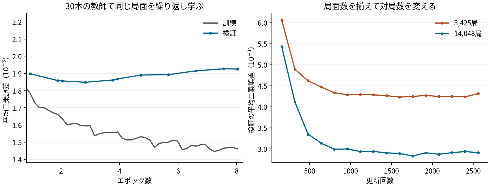

# 中将棋の評価関数で過学習が起きる条件

tatara方式のP型評価関数では、同じ数の局面を学ぶ場合でも、何局の棋譜から採ったかで棋力が変わった。訓練局面数を1,296,697、バッチ更新を2,560回に揃えると、14,048局から疎に採ったモデルは、3,425局から学習対象の全局面を採ったモデルに対し、1手3,000ノードの直接対局で+205.6 Eloだった。以下ではこの教師の多様性と、同じ教師を何回学ぶかの効果を調べる。

測定には、比較相手となる `master` ブランチの標準ネットの学習に使った日本中将棋連盟ルールの教師30ファイルと、その先頭の2ファイルを用いた。評価関数の実装は、駒種と升を入力とする差分更新型ニューラルネットワーク（NNUE）のLayerStackである。適格局面とは、教師生成時の探索値があり、学習からの除外指定がない局面をいう。終局得点は同じ棋譜の勝敗から得た。特記のない限り、探索値を勝率に換算して教師とし、検証用には学習に使わない対局を丸ごと取り分けた。[元の教師と修整実験](../../audits/tatara-p-repair-2026-11-19.md)

## 同じ教師を繰り返すと検証損失が悪化した

P型をtataraの構造に移して棋力低下が起きたときの教師は、第2世代の37ファイルだった。この学習では、重みを更新して初めて検証損失を測った時点で、すでに8.29エポックに達していた。そこから66.35エポックまで訓練損失は0.000798から0.000619へ下がる一方、検証損失は0.001297から0.001447へ上がった。修整に用いた教師30ファイルでは検証間隔が短いため、悪化に転じた時期をより細かく調べられる。[第2世代の学習記録](../nnue-tatara-framework-and-halfkp-vm/nnue-tatara-framework-and-halfkp-vm-training.md)

| エポック | 更新回数 | 訓練損失 | 検証損失 | 標準ネットとの得点率 |
|---:|---:|---:|---:|---:|
| 0.94 | 4,578 | 0.001785 | 0.001898 | 44.5% |
| 2.05 | 9,919 | 0.001636 | 0.001857 | 47.9% |
| 2.83 | 13,734 | 0.001594 | 0.001849 | 未測定 |
| 3.93 | 19,075 | 0.001560 | 0.001868 | 37.5% |
| 8.02 | 38,913 | 0.001461 | 0.001926 | 33.3% |

訓練損失は直前763更新の平均で、検証損失は各時点の実数モデルで検証4,153,303局面を評価した平均二乗誤差である。標準ネットとの対局で使った共通の96組の開始局面を単位に20,000回復元抽出すると、8.02エポックと2.05エポックの得点率の差は−14.58ポイント、95%信頼区間は［−23.18, −6.25］ポイントだった。この2時点は以前の候補比較に含まれている。[元の候補比較](../../audits/tatara-p-repair-2026-11-19.md#教師と学習期間)

検証損失の最小は2.83エポックだった。新しい開始局面で直接比較するため、2.05エポックのチェックポイントから元の学習率と順列で学習を再開し、13,734更新で当時の検証損失0.001848900243を再現した。整数化したモデルでの全検証局面の予測誤差も、8.02エポックの0.001944から2.83エポックの0.001866に下がった。直接対局の最初の96組では、2.83エポックは8.02エポックに対し+32.7 Elo［−10.4, +76.7］、以前の対局で選んだ2.05エポックに対し−5.4 Elo［−54.9, +43.8］だった。[8.02エポックとの直接対局](full-vs-late.md)・[2.05エポックとの直接対局](full-vs-match-choice.md)

2.83エポックと8.02エポックの差を確かめるため、別の開始局面を384組と決めて比較した。手数上限に達した1組を除く383組で、2.83エポックのモデルが+51.6 Elo［+28.2, +75.5］上回った。この教師では、検証損失から選んだ時点のモデルが長く学んだモデルに勝った。2.05エポックとの優劣は96組の比較からは決まらない。[独立した384組での確認](full-vs-late-confirm.md)

訓練損失と検証損失が逆方向に動いたのは、重みを対局用に整数化する処理（量子化）より前だった。実数評価と整数評価の平均絶対差は、2.05エポックで13.92 cp、3.93エポックで39.98 cp、8.02エポックで12.31 cpだった。中間の時点では整数化の誤差も大きいため、量子化前の損失で選んだ重みは、整数に書き出した上で対局させる。cpは歩兵1枚の価値の100分の1である。

## 棋譜内の相関と対局数の効果

教師30ファイルの222,636局には、訓練と検証を合わせて83,611,385の適格局面があった。手番が替わるたびに符号が反転する影響を取り除くため、各探索値を棋譜の開始時に手番を持つ側の勝率へ換算し、同じ棋譜の適格局面の平均を引いた。元の棋譜でちょうど指定手数だけ離れ、両端とも適格な局面対を集めて相関係数を求めた。

| 間隔 | 局面対の数 | 対局内平均を引いた探索勝率の相関係数 |
|---:|---:|---:|
| 1手 | 74,328,959 | 0.989 |
| 2手 | 71,701,554 | 0.988 |
| 8手 | 69,748,377 | 0.963 |
| 16手 | 68,138,892 | 0.918 |
| 32手 | 65,207,712 | 0.816 |

探索値が似ていても、モデルの誤差まで同じとは限らない。そこで2.83エポックの整数モデルについて、検証4,153,303局面で予測勝率から教師の勝率を引き、先後の向きを揃え、対局内平均を引いて同じ計算を行った。誤差の相関係数は1手で0.678、2手で0.528、8手で0.170、16手で0.083、32手で0.030だった。隣接局面ではモデルの誤差にも相関が残る。ただし、これらの値から勾配の相関や独立な訓練例の実効数は決まらない。

対局数が学習に与える影響を確かめるため、最初の2ファイルの訓練対局を使い、モデルに与える局面数を固定して対局数を変えた。密に採る条件は対局を約1/4に絞り、疎に採る条件は全訓練対局から局面を約1/4ずつ抽出した。疎な側で無作為に選んだ28,259局面を訓練対象から外し、両条件の訓練局面数を一致させた。

| 訓練集合 | 対局数 | 局面数 | 2,560更新後の訓練損失 | 同じ275,717局面での検証損失 |
|---|---:|---:|---:|---:|
| 少数の対局から全適格局面を採る。 | 3,425 | 1,296,697 | 0.000930 | 0.004315 |
| 全対局から一部の適格局面を採る。 | 14,048 | 1,296,697 | 0.001222 | 0.002908 |

両条件で初期値、学習率、乱数シード1、バッチ4,096局面、エポック末のバッチサイズまで揃えた。訓練局面はエポックごとに全体を並べ替えている。密に採った側は訓練集合によりよく適合したが、未知の対局を予測する精度は劣った。残り28ファイルの検証対局から採った61,209局面でも、整数モデルの探索勝率の二乗誤差は0.004039から0.002929へ下がった。差は−0.001110で、10,253局を単位にした対応のある95%信頼区間は−0.001235〜−0.000994だった。

2,560更新（8.08エポック）で両者を直接対局させると、多くの対局から採った側が+205.6 Elo［+157.0, +262.9］だった。局面数を厳密に揃える前の1,324,956局面を使う比較でも+122.5 Elo［+73.1, +177.1］だった。[局面数を揃えた直接対局](matched-volume-match.md)・[両条件を約1/4に抽出した直接対局](diversity-match.md)

以前の第2世代の教師でも、同程度の局面数なら多くの対局から採った側が短時間対局の逐次検定で優勢だった。[第2世代の対局数比較](../nnue-generation-reset/nnue-generation-reset-gen2-diversity.md)

一方、最小値から8.08エポックまでの検証損失の増加は、密な側で0.000084、疎な側で0.000079だった。対局数を増やすと同じ学習量での汎化は改善したが、長く学んだときの悪化は両方に残った。元の30ファイルでの棋力低下のうち、棋譜内の相関が占める割合は、この縮小実験からは推定できない。

教師を作った世代も成績に関係する。先行測定では、同じ2.05エポックまで学んだtatara方式のP型同士でも、標準ネットと同じ教師を使った側が第2世代の教師を使った側に+126.0 Elo［+92.7, +161.7］だった。この比較では棋譜の局面分布と付与された探索値が同時に変わるため、どちらの寄与かは分からない。[教師を入れ替えた直接比較](tatara-repair-two-epochs-teacher-new.md)

## 学習率の減衰期間も最良時点を動かした

疎に採った1,296,697局面を同じ順で学び、初期学習率0.001と下限倍率0.027を固定して、余弦減衰の期間だけを変えた。元の390,656更新の予定では、2,560更新までの学習率はほぼ一定だった。減衰期間を2,560更新にすると、検証損失の最小は5.55エポックから7.57エポックへ移り、最終損失は0.002908から0.002666へ下がった。残り28ファイルの検証標本でも整数モデルの損失差は−0.000182［−0.000225, −0.000141］だった。

短い減衰期間のモデルと長い減衰期間のモデルを同じ2,560更新で直接比較すると、棋力差は+30.8 Elo［−14.9, +77.7］だった。学習率の違いによる未知の探索値への適合の改善は確認できたが、対局結果から標準の減衰期間を決めるには精度が足りない。学習期間を比較するときは更新回数と学習率の推移を併記する。[減衰期間を変えた直接対局](schedule-match.md)

## 終盤に勝敗を混ぜた効果

修整実験で使った2.05エポックの重みから、修整実験と同じ262,144局面を同じ順で2エポック追加学習した。残り25枚以下の65,536局面に限り、探索値から求めた勝率75%と終局得点25%の加重平均を教師にした。対照には、探索勝率だけを教師として同じ条件で実数の重みを更新したモデルを用いた。終局得点は手番側から見て、勝ちを1、引き分けを0.5、負けを0とした。学習率は0.00003、バッチは512局面である。[追加学習の対照と訓練標本](../../audits/tatara-p-repair-2026-11-19.md#終盤の再探索と量子化を模擬した学習)

| 未学習対局での整数モデルの平均二乗誤差 | 探索値のみ | 終盤で勝敗25% | 差の95%信頼区間 |
|---|---:|---:|---:|
| 終盤697,569局面での終局得点に対する誤差 | 0.046612 | 0.046318 | ［−0.000517, −0.000063］ |
| 同じ終盤での探索勝率に対する誤差 | 0.001187 | 0.001245 | ［+0.000043, +0.000074］ |
| 全4,153,303局面での終局得点に対する誤差 | 0.153723 | 0.153615 | ［−0.000153, −0.000065］ |

最初に調べた終盤10,863局面の標本では、勝敗予測誤差の差の95%信頼区間は0をまたいだ。そこで検証用11,112局の全局面を評価した。終盤を含む6,013局では、勝敗を25%混ぜると終局得点の予測誤差は0.000294下がり、反対に探索値の予測誤差は0.000058上がった。開始局面からの直接対局では−14.5 Elo［−62.1, +32.6］であり、勝敗予測の改善が棋力に及ぶかは判別できなかった。今回調べたのは1つの初期重みからの追加学習であり、別の混合比や学習開始時からの適用については測っていない。[終盤の混合比を変えた直接対局](ending-match.md)

## 標準レシピへの反映

標準レシピv3では、計算量の制約で訓練局面を減らす場合は、できるだけ多くの対局から採る。全量を学習できる場合に間引く利益は、この比較では測っていない。各世代で約0.5エポックごとに未学習対局の損失を測り、2回続けて改善しなければ、それまでに最小損失を記録した重みを整数化する。密に採った2ファイルでこの手順を実行すると、1,920更新（6.06エポック）で学習が止まり、最小損失だった1,600更新（5.05エポック）の重みが選ばれた。この重みと2,560更新時点の重みとの直接対局は+41.8 Elo［−6.4, +91.7］だった。停止時点と採用候補の時点を分けることで、過学習を確認した後でも良かった時点の重みを使える。[停止条件の直接対局](selection-match.md)・[標準レシピ](../../guides/nnue-training.md#標準レシピ)

## 測定条件と再現手順

2026年11月19日にIntel Core Ultra 7 265KFとGeForce RTX 3060 Tiを使った。今回の直接対局は、すべてエンジン `8b853b66`、1手3,000ノード、1スレッド、置換表32 MB、日本中将棋連盟ルールで行った。各条件でシード20261119950000から開始局面を96組生成し、先後を入れ替えた。教師30ファイルの2.83エポックと8.02エポックの追加比較には、別のシード20261119990000から生成した384組を用いた。区間は比較ごとの95%信頼区間で、多重比較の調整は行っていない。持ち時間を用いる採否の検定は別に行う。静的評価の差の区間は、同じ検証対局を両モデルに対応づけて2,000回復元抽出し、抽出した全局面での平均の差から求めた。

[再現用のスクリプトと数値記録](tatara-p-generalization/reproduce.tar.gz)には、訓練と検証の曲線、使用した重みのチェックサム、直接対局の条件とペア別得点を収録した。教師ファイルと重みは測定機の本体リポジトリの `data/` 以下にある。展開先と実行順は付属の `README.txt` に記した。
