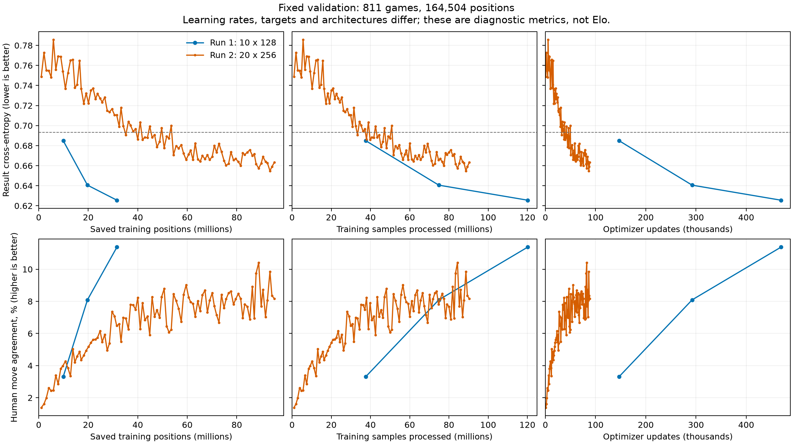

# 2回目の自己対局学習の遅れと改善候補

2回目の強化学習では、ネットワークの大型化と同時に、生成量に対する学習量と、新しい教師を学習へ反映する速さが下がっている。
まず既存のネットと教師データを使い、追加学習の効果と、リプレイバッファの対象期間を絞る効果を確かめることを勧める。
ただし、学習した標本数を揃えても価値予測の差が残るので、学習量だけで遅れを説明することはできない。
価値ヘッドの縮小、対局の多様性の低下、および探索の浅さによる教師の質の問題も、影響を切り分ける必要がある。

本書は2026年11月17日時点の調査であり、[1回目の系列](../training/alphazero-rl-1/README.md)のサイクル1〜32と、[2回目の系列](../training/alphazero-rl-2/README.md)のサイクル1〜100を比較する。
対象は、方策と価値を出すネットでモンテカルロ木探索を導くPV-MCTSであり、自己対局ではGumbel AlphaZeroを使う。
本書でいう「保存局面」は生成の集計にある訓練対象の局面、「学習標本」は重みの更新に実際に投入した局面を重複込みで数えたもの、「更新」は1バッチによる重みの更新である。
2系列では各手番の局面を訓練対象として残す条件が違うため、この3つと対局数を分けて比較する。

## 比較で確かめられた差

2回目の遅れは、対局結果と固定棋譜の診断の両方に現れている。
1手500ノードのαβ探索に対し、1回目のサイクル32は200局で得点率52.5%、2回目のサイクル100は16局で6.25%だった。
後者は対局数が少なく、正確なElo差や「1回目の何サイクル相当か」を決めるには足りない。
固定した人間の棋譜811局、164,504局面でも2回目の価値予測が遅れているので、診断を進める根拠はある。
相手と探索条件の詳細は、[1回目の対局](../measurements/mcts-fixed-opponents/mcts-fixed-opponents-alphabeta-baseline.md)と[2回目の短い対局](../measurements/alphazero-rl-2/alphazero-rl-2-short-matches-c0010-c0100.md)にある。

| 比較項目 | 1回目、サイクル32まで | 2回目、サイクル100まで |
|---|---:|---:|
| ネットの残差ブロック数とチャネル数 | 10、128 | 20、256 |
| 学習時のパラメータ数 | 4,780,200 | 25,182,204 |
| 累計保存局面 | 31,594,296 | 95,191,852 |
| 累計学習標本 | 120,180,504 | 90,375,168 |
| 累計更新 | 469,470 | 88,257 |
| 累計対局 | 370,573局 | 268,896局 |
| 累計着手 | 135,911,075手 | 95,041,128手 |
| 全体のバッチサイズ | 256 | 1,024 |
| 新規訓練局面数に対する抽出数 | 4倍 | 1倍 |
| 学習率 | 各サイクルで0.01からほぼ0へ低下 | 初期の250更新後は0.04 |
| 最終ネットの固定棋譜での価値損失 | 0.6255 | 0.6634 |
| 最終ネットの人間の着手との一致率 | 11.38% | 8.16% |

局面数、対局数、および着手数は系列のCSV、学習標本と更新数はネットワーク接続の記憶装置にある実行器の原記録から再集計した。
1回目のサイクル8は、CSVの定義どおり生成し直した対局も含む。
パラメータ数の出典は[1回目の初期ネット](../measurements/alphazero-restart-techniques/alphazero-restart-techniques-random-net-output-check.md)と[2回目の構成変更](../plans/archived/zero-recipe-precedents.md)である。
表は「2回目は保存局面を約3倍作ったが、学習標本も対局数も1回目の終了時に届いていない」ことを示す。

2系列では、学習の規則セット、開始局面、および投了の運用も変わっている。
1回目は規則セット`JCSA`で初期局面から8〜16手を一様に乱択して始め、2回目は規則セット`lishogi`で標準の初期局面から始める。
投了で終わった割合も、1回目のサイクル32は5.79%、2回目のサイクル100は69.44%だった。
このため、既存の2系列から個々の変更の因果効果は取り出せず、同じ重みから分岐する比較が必要になる。



図の上段は対局結果に対する2値交差エントロピー、下段は人間の着手との一致率である。
横軸は左の図から順に保存局面、学習標本、更新数である。
破線は勝敗を常に五分と予測したときの損失ln 2を示す。
実線は測定点を見やすく結んだだけで、点の間を測定したわけではない。
1回目の学習後の固定棋譜診断はサイクル10、20、32の3点だけなので、更新数を揃えた精密な比較もできない。
これらは棋力そのものの指標ではなく、原因を調べるための診断である。

## 学習量と価値予測

保存局面あたりの更新回数は、2回目で約16分の1になった。
検証用の対局を除いた新規局面数をNとすると、1回目はおよそ4N/256回、2回目はN/1,024回更新する。
1サイクルあたりの更新数は、1回目のサイクル32が15,043更新、2回目のサイクル100が944更新であり、原記録もこの差と一致する。
ただし、バッチの拡大に合わせて学習率も上がり、1回目には毎サイクルの減衰があるので、更新数の比をそのまま学習効果の比にはできない。
この試算は「16倍更新すれば同じ強さになる」という予測ではなく、学習不足を先に検査する根拠である。

学習標本数を揃えると、方策の差は小さくなる一方、価値予測の差は残る。
1回目のサイクル20は7,484万標本で価値損失0.6405、一致率8.10%であり、2回目のサイクル82は7,471万標本で0.6656、7.81%だった。
2回目のサイクル100は9,038万標本まで学んでも価値損失0.6634で、サイクル60〜100の最良値もサイクル98の0.6548だった。
したがって、同じ保存局面で比べた大きな差の一部は抽出量で説明できるが、残った価値予測の遅れには別の要因がある。

追加学習は、この残った差を調べる最も直接的な手段になる。
サイクル100の同じ重みと同じ教師から始め、学習率とネット構造を固定して標本数を増やし、訓練に使わない対局での価値損失と、固定相手との対局成績が改善するかを見る。
訓練損失だけが下がる場合は過学習か教師の分布の問題を疑い、訓練損失も下がらない場合は学習率、勾配、活性化、および学習処理を点検する。
[系列の記録](../training/alphazero-rl-2/README.md)には、サイクル100からの追加学習を始めたとあるが、本書はその未完了の結果を結論に使っていない。

## 新しい教師の利用が遅い

2回目のリプレイバッファは、サイクル100でも全履歴を保持している。
上限は150万局だが、生成済みは268,896局であり、一度も上限に届いていない。
実装は局数の上限内のサイクルを残し、その全訓練局面から新規訓練局面と同じ数を一様に抽出する。
このため、自己対局を1サイクル進めても、新しいネットの判断が次の学習に占める割合は小さい。
この挙動は[リプレイバッファのADR](../adr/sample-as-many-positions-as-generated-from-a-zero-replay-buffer-of-the-latest-1-5-million-games.md)と、`runner.py`の`replay_buffer`、`data.py`の`read_replay_buffer`で確認した。

サイクル100の訓練対象は全体で90,429,193局面、うち新規局面は967,579である。
このサイクルで処理した966,656標本のうち、新規局面の期待値は約10,343標本、割合は1.07%にすぎない。
サイクル1〜50が全体の50.18%、直近10サイクルが9.36%を占め、抽出元の局面が生成されてからの経過サイクル数は平均49.79である。
古い教師を残すことは忘却や過学習を抑える一方、改善した方策を新しい自己対局へ返す速度を落とすため、この配分には比較実験の余地がある。

この利用の遅れは、全体の学習標本数からは見えない。
各サイクルでN局面ずつ追加し、c番目に全cN局面からN標本を抽出する近似では、新規局面がすぐに使われる確率は1/cになる。
各サイクルの抽出を独立とすれば、k番目に加えた局面がC番目まで未使用である確率は、積∏_{c=k}^C(1−1/c)＝(k−1)/Cである。
実際の不均等な局面数とバッチ端数で再計算すると、100サイクル時点の未使用割合の期待値は全体で49.51%、最新50サイクルでは74.60%になる。
これは実際の抽出列を再生した測定ではなく、抽出規則からの期待値であり、未使用の局面が将来も使われないという意味ではない。

比較候補は、同じ標本数、学習率、バッチで、全100サイクルと直近16サイクルを学ぶ2群である。
16は最適値の主張ではなく、将棋の[Gumbel dlshogi](https://github.com/TadaoYamaoka/gumbel-dlshogi/blob/master/gumbel_dlshogi/run.py)が持つ対象期間の調整と、[既存調査に記録した1、2、4、8、16サイクルの先例](alphazero-training-sample-selection.md)を出発点にした試験値である。
対象期間を1サイクルだけに縮めると、数千局の勝敗を記憶する危険があるため、期間を絞る試験では訓練に使わない直近の対局と固定棋譜の両方で改善を確かめる。
最新データの反映が遅いという仮説が正しければ、同じ学習量でも直近の教師への適合と対局成績が改善するはずである。

## 対局数と教師の質

1回目と2回目では、同じ保存局面数に含まれる対局数が違う。
1回目は手番の25%を32回、残りを8回探索し、32回探索した局面だけを訓練対象にした。
2回目は全手番を32回探索して記録するので、同じ保存局面数をより少ない対局から集める。
サイクル20までの保存局面は1回目1,969万、2回目1,916万と近いが、対局数は263,630局と61,415局で4.29倍違う。
同じ対局の多数の局面が1つの勝敗を共有するため、保存局面数だけでは価値の教師の多様性を比べられない。

この差を「2回目の1手の探索が浅くなった」と読むのは誤りである。
方策を学ぶ局面では両方とも32回探索し、2回目はほかの手も32回読む。
1回目の探索回数の乱択が有利だったとすれば、要因として考えられるのは、少ない計算で多くの対局を進められる効果である。
通常の32回と高速の8回を25%と75%で混ぜ、各手の根のネット評価も1回と数える近似では、保存局面1つあたりのネット評価は1回目60回、2回目33回になる。
4倍と1倍の抽出を合わせると、ネット評価1回あたりの学習標本は4/60と1/33で、2回目が約45%になる。
早期終局、枝の確定、およびネット1回の計算量の差を無視した計算であり、実測の速度比とは区別する。

32回という探索予算自体も、学習量の次に検証する候補である。
サイクル100の生成データでは合法手数の平均が83.7、中央値が86である一方、Gumbel探索の根の候補は最大16手である。
16候補に32回を配る通常の場合、最後に残る候補の訪問は4回にとどまり、価値予測の誤差が教師に入りやすい。
Gumbel AlphaZeroの原論文で2〜32回を系統比較した対象は9路囲碁であり、チェスの実験は400回だった。
少数探索でも学べるという結果は、中将棋で32回が計算効率の最適値であることを保証しない。[Danihelkaら、第3節、第7節](https://davidstarsilver.wordpress.com/wp-content/uploads/2025/04/gumbel-alphazero.pdf)。

まず保存局面の同じ集合に32回と128回の探索をかけ、選ぶ手の変化、価値の差、および明確な駒損の見落としを調べると、全面的に生成量を増やす前に教師の弱点を見つけられる。
128回は4倍の探索予算を比較する試験値であり、最適値として推奨するものではない。
教師の改善が認められた場合に、同じ計算時間で回す学習の比較へ進む。
既存棋譜の局面に探索をやり直す方法も候補になるが、方策や探索値を付け直しても記録された対局の勝敗は新しいネット同士の対局結果に置き換わらないので、教師のどの部分を変えたかを分けて扱う。

## ネットの大型化だけでは比較できない

2回目はネット全体が約5.27倍になった一方、価値ヘッドの途中のチャネル数は32から1へ減っている。
全結合層へ渡す特徴は4,608個から144個になり、大域プーリングと補助目標も取り除かれた。
したがって、大きいネットが同じ問題を単に遅く学んでいるという比較にはなっていない。
変更前はコミット`aa9a7fa8`、変更後は`556e90aa`の`tools/train/zero/minase_zero/net.py`と`train.py`、変更の理由は[構成のADR](../adr/shape-the-zero-network-as-the-alphazero-resnet-with-a-two-layer-policy-head-and-a-one-channel-value-head.md)と[損失のADR](../adr/train-the-zero-network-on-the-policy-and-value-losses-without-auxiliary-targets.md)で確認した。

価値ヘッドの狭さは、学習標本数を揃えても価値の遅れが残ることと整合するが、原因としては未検証である。
まず現行の構成で追加学習とリプレイバッファの範囲の変更を試し、それで差が埋まらなければ、方策と価値に共通の層の構成を揃えたまま、価値ヘッドだけを広げる比較を行うのがよい。
補助目標や大域的な情報交換も同時に戻すと、改善しても何が効いたか分からなくなる。
なお、Gumbel論文はチェスにもbottleneck残差ブロックとglobal broadcastingを使い、同精度で約2倍速い構成を報告している。
その方式は1回目の大域プーリングと同一ではないが、大域的な情報交換の根拠を囲碁だけに限定する必要はない。[Danihelkaら、付録F.1](https://davidstarsilver.wordpress.com/wp-content/uploads/2025/04/gumbel-alphazero.pdf)。

さらに大きなネットへ進む前には、小さいネットの棋力を計算時間で評価する必要がある。
KataGoは小さいネットから始め、大きいネットを同じ棋譜で学習させ、損失が追いついてから切り替えた。[Wu、第2節](https://arxiv.org/html/1902.10565v5)。
minaseでも、既に自己対局で学んだネットからの蒸留や継続学習なら、毎回ランダム初期化から棋譜を作り直す費用を避けられる。
ただし、現時点では20ブロック256チャネルが過大だと断定できず、まず保存済みの重みから改善できる範囲を測る。

## 計算時間の配分

2回目のサイクル100では、学習標本を増やす試験の追加費用は、サイクル全体を倍増させるほどにはならないと見込まれる。
実行器の工程の合計は938.2秒で、その内訳は生成514.0秒、学習工程277.3秒、出力の照合146.8秒だった。
学習工程のうち、更新ループは89.7秒、データ読み込みは72.8秒、最終診断は9.9秒であり、残りは起動、コンパイル、書き出しなどを含むが、この記録では個別に分離できない。
直近20サイクルでも更新ループの中央値は85.6秒なので、1回だけの極端な値ではない。
これらは処理の経過時間であり、GPU使用率の測定ではない。

更新ループだけが標本数に比例し、ほかの時間が変わらないと仮定すると、学習標本を4倍にしたサイクルは938.2＋3×89.7＝約1,207秒、約20.1分になる。
工程の時間は約1.29倍、時間あたりの学習標本は約3.1倍になる計算だが、標本の読み込みと診断も増えるので、実際の延長はこの見積もりより大きくなり得る。
棋力の伸びがこの比率で改善するという予測ではなく、既存データの利用量を変える短い比較が実行しやすいという費用上の根拠である。

この結果だけで、生成より学習に計算資源を多く配るべきだとは言えない。
KataGoの公式手引きも、自己対局に学習の4〜40倍のGPU計算資源を使うことを目安とし、4倍の標本比を保守的な設定とする一方、過学習に注意するよう述べる。[KataGoの手引き](https://github.com/lightvector/KataGo/blob/master/SelfplayTraining.md)。
採否は、同じ時間または同じ費用でどれだけ強くなったかで決める。
当面はコードの低水準の高速化より、既存の計算配分で学習が追いついているかを確認する方が優先される。

## 比較の順序と判断

最初に、サイクル100からの追加学習を診断し、効果が出た標本数を基準に短い自己対局の継続比較へ進む。
学習率0.04の追加学習で改善が乏しい場合は、同じ重み、抽出列、標本数、およびバッチで0.004も比較し、高すぎる学習率による停滞かどうかを切り分ける。
0.004は現行の[学習率のADR](../adr/keep-the-zero-learning-rate-constant-after-a-250-update-warmup-and-cut-it-tenfold-on-stalls.md)が定める次の段階だが、本書では本線への引き下げを確定しない。
サイクル番号だけを理由に下げず、既存教師への適合と、新しい自己対局での改善の両方を見る。

次に、同じ学習量のままリプレイバッファの範囲だけを比較する。
学習量とリプレイバッファの範囲を同時に変えるとそれぞれの寄与が分からないため、まずそれぞれを分離する。
有望な変更は同じ計算時間の自己対局を含む複数サイクルで比べ、固定教師だけで得た改善が続くかを確かめる。
その後に探索予算、対局の多様性、価値ヘッド、およびネットの規模を比較する順序を勧める。

評価は、固定棋譜の診断と固定した相手との対局を併用する。
1回目のサイクル20または32と、2回目の基準と候補を、同じ実行バイナリ、規則、探索回数、および開始局面で測り直すと、以前の対局条件の差を除ける。
16局でほぼ全敗する相手だけでは小さな改善を検出しにくいので、拮抗する保存済みネットも相手に加える。
固定探索量で学習の効果を比較した後、実用時の改善は持ち時間を揃えた対局で確認し、棋力に関わる変更の最終的な採否は[棋力測定の手引き](../guides/sprt.md)の逐次検定に従う。
学習乱数によるばらつきは対局数だけでは消えないため、短い試験で候補を絞った後は、独立な学習の再実行でも確認する。

診断値を読む際には、現在の訓練診断の局面数の少なさにも注意が要る。
サイクル100の最新データからの訓練診断は491局面、91局なのに対し、検証診断は37,816局面、81局であり、単一サイクルの訓練損失と検証損失の差は不安定になり得る。
対局単位で固定したデータ集合で比較し、価値の平均誤差を手数帯と終局までの距離ごとに集計すると、長い対局の勝敗を予測できないのか、終盤でも読み違えているのかを分けられる。
方策の損失も教師分布のエントロピーに左右されるため、異なるサイクルの交差エントロピーだけで適合の良否を判断せず、同じ教師に対する差や教師とのKLダイバージェンスを使う。
KLダイバージェンスは、ここでは教師の方策分布とネットの方策分布の隔たりを測る量を指す。

本書の候補には、2026年11月15日に決めた設定を再検討するものが含まれる。
とくに探索回数の乱択、補助目標、およびネット構造の変更は、[先行実装に揃える設計書](../plans/archived/zero-recipe-precedents.md)に記録された方針に関わるため、原因候補と採用の決定を区別した。
KataGoの訪問回数から教師を作る方式向けのpolicy target pruningを、そのままGumbelの改善方策に足すことも勧めない。
本調査では学習設定とエンジンを変更せず、新しい学習や有料の計算も開始していない。

## 集計の再現

数値の再計算には、[集計スクリプト](alphazero-rl-2-efficiency/analyze.py)、[サイクルごとの集計](alphazero-rl-2-efficiency/cycles.csv)、および[要約と入力のハッシュ](alphazero-rl-2-efficiency/summary.json)を残した。
原記録の学習済みサイクル数が変わった場合はスクリプトが停止し、本調査で固定した比較範囲を自動では広げない。
リポジトリの根で次のコマンドを実行すると、集計と図を作り直せる。

```console
uv run --frozen --project tools/train/progress python docs/research/alphazero-rl-2-efficiency/analyze.py --records-root /mnt/synology_nas/minase/alphazero
```

時間の集計は原記録の生成、学習、および照合の工程に限り、計算機の準備、転送、固定棋譜の外部診断、対局測定、および工程外の待ち時間を含まない。
1回目の原記録では再生成の時間が独立に揃っていないので、合計を課金時間とはみなさない。
2系列のGPUも異なるため、この合計からネット構造の速度差や費用対効果を直接推定していない。
