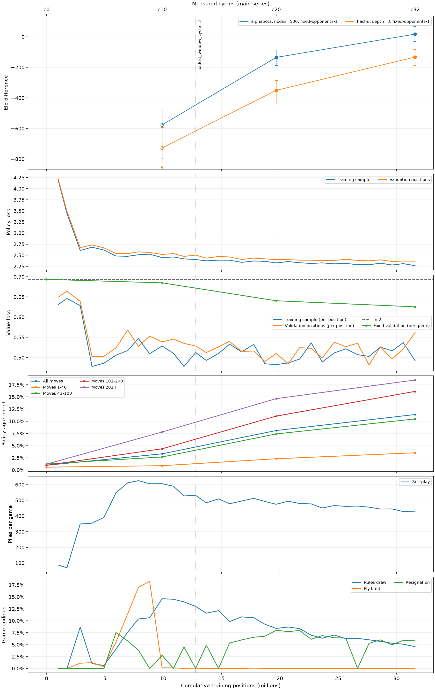

# 1回目の強化学習の系列

## 系列の説明

本書は、中将棋エンジンminaseのAlphaZero型探索の強化学習のうち、1回目の実行の系列のページである。
AlphaZero型探索は、ニューラルネットワーク（以下、ネット）でモンテカルロ木探索（以下、MCTS）を導く探索であり、強化学習は、前のサイクルのネットによる自己対局の生成と、ためた局面による学習を1サイクルとして繰り返す。
この系列は、10ブロック128チャネルのネットをシード20261031でランダムに初期化したサイクル0から始め、サイクル32まで回して中断した（[1回目の実行の設計書](../../plans/archived/alphazero-rl.md)）。
2回目の実行（[設計書](../../plans/alphazero-rl-2.md)）では、この系列の強さと診断の値を基準として並べて読む。

自己対局と学習は、Google Colab（以下、Colab）のNVIDIA L4の機械で、実行器`minase_zero run-cycles`が行った。
自己対局の規則は、日本中将棋連盟の規則に基づく規則セット`JCSA`である。
実行器の系列の名前（`--cycles-dir`の値）は`cycles`であり、系列の記録はネットワーク接続の記憶装置（以下、NAS）の`/mnt/synology_nas/minase/alphazero/cycles.jsonl`、各サイクルのチェックポイントとネットは同じディレクトリの`cycles/cycle-<4桁のサイクルの番号>/train/`にある。

この系列の前に、学習率の予定（cosine annealing）が入っていないまま回したサイクル1〜37の学習があり、2026年10月31日の利用者の決定で出力を削除した。
その学習は別の系列であり、本書の図と値には含めない（[リセット前の経過](../../measurements/alphazero-rl/alphazero-rl-pre-reset-history.md)）。

## 状態

本書は系列の終了時に凍結した記録であり、以後は、後から行う測り直しの行を「測定の条件」と「測定記録」の節に足すほかは書き換えない。

系列は、2026年11月2日にサイクル32を終えた後に止め、2026年11月9日の利用者の決定で中断した。
途中で手数の上限、リプレイバッファの範囲、および重みの移動平均の書き出しを変え、さらにサイクル32の後に、探索木の葉で最後の王駒を取れるかの判定を採用したので、決まっている変更をすべて最初から入れて、2回目の実行でやり直すことにした。
最後の定例の測定はサイクル30の進捗測定であり、その後にサイクル32のネットを使うMCTSとαβ探索の、持ち時間つきの対局を行った。

## 進捗図

## 読み取れること

固定の相手に対するEloの差は、どちらの相手でもサイクル10、20、32の順に上がった。
1手500ノードのαβ探索に対しては−576［−798, −478］、−135［−187, −88］、+17［−31, +67］であり、深さ3の中将棋の外部エンジンHaChuに対しては−727［−∞, −594］、−351［−441, −286］、−133［−187, −84］である。
角括弧は95%信頼区間であり、各相手の条件は「測定の条件」の節にある。
サイクル10の2点は、得点率（引き分けを0.5点とした得点の割合）がαβ探索に対して3.5%、HaChuに対して1.5%であり、2回目の実行の設計書が相手の制限を改める目安とする10%を下回るので、図では白抜きの点にしてある。
HaChuに対するサイクル10の信頼区間の下端は、得点率の区間の下端が0になるので負の無限大であり、図では誤差棒の下の矢印で示した。
αβ探索の値とHaChuの値は別々の相手に対する差なので、2本の線の上下の位置から、2つの相手のどちらが強いかは読まない。

対局は、同じ開始局面で先後を入れ替えた2局を1ペアとして数える。
上のEloは、どちらかの対局が手数の上限に達したペアを破棄して除き、HaChuの拒否着手と不正着手で終わった対局をHaChuの反則負けとして数えた値である。
拒否着手は、minaseの審判が認めたMCTSの着手をHaChuが受け付けなかったものであり、不正着手は規則に反する着手である。
HaChuとの対局では、拒否着手または不正着手を含むペアと、破棄したペアを合わせた割合が、サイクル10、20、32で1%、6%、16%と増えた。
拒否着手または不正着手を含むペアも除いたEloは−796、−380、−164であり、破棄したペアを2敗とした場合と2勝とした場合のEloは、サイクル20で−354と−323、サイクル32で−143と−111である。
αβ探索との対局には、該当するペアがない。

固定の検証用データでは、価値の損失がサイクル0の0.6934から、サイクル10の0.6848、20の0.6405、32の0.6255へ下がり、人間が指した手との一致率は0.96%、3.32%、8.10%、11.38%へ上がった。
手数の帯ごとの一致率は、どのサイクルでも1〜40手目が最も低く（サイクル32で3.53%）、サイクル10以後は201手目以降が最も高い（同18.46%）。
一方、自己対局のデータでの価値の損失は、サイクル4以後、訓練の標本と検証局面のどちらも0.48〜0.57の間を上下するだけで、下がり続けてはいない。
自己対局の価値の損失は、ネットが強くなると教師となる対局の内容も変わるので、強さの推移の目安には使えず、自己対局と独立な固定の検証用データの値のほうが、強さの線と同じ向きに動いている。

方策の損失は、サイクル1の4.20（訓練の標本）からサイクル3の2.61へ急に下がり、その後はサイクル32の2.27までゆっくり下がった。
検証局面と訓練の標本の差は、サイクル3〜9の0.039〜0.065から、サイクル26〜32の0.058〜0.101へ広がった。
この差は過学習の目安なので、後半のサイクルほど、学習に使った局面に合わせすぎる傾向が強まったと読める。
サイクル14でリプレイバッファの最古のサイクルを1から3へ改めたとき、検証局面の方策の損失は2.504から2.436へ、価値の損失は0.529から0.512へ下がったが、前後のサイクルにも同じ程度の上下があり、範囲の変更の影響とは区別できない。

1局の手数は、サイクル2の70手からサイクル8の625手へ延び、その後はサイクル32の431手まで縮んだ。
手数の上限に達した対局の割合は、サイクル9に18.3%まで増え、サイクル10で0.1%へ下がった。
この低下は、サイクル10から手数の上限を1,000手から3,000手へ改めたためである。
進捗図は、設定の列の値が変わったサイクルに縦線を引くが、手数の上限は系列の記録に欄がないので、この変更の縦線は現れない。
引き分けの割合はサイクル10の14.6%を頂点に、サイクル32の4.6%まで下がった。
投了の割合が0%のサイクル（1〜5、9、11、13、15、27）は、実行器が投了を止めたサイクルである（記録の`resign_calibration.enable_resignation`が偽）。
実行器は、前のサイクルで最後まで指させた対局から投了の誤りの割合の上限を求め、その対局が100局に満たないか、上限が5%を超えると、次のサイクルの投了を止めた。

サイクル21〜25では、重みの移動平均も書き出した（[比較の記録](../../measurements/alphazero-rl/alphazero-rl-ema-c0025.md)）。
自己対局には移動平均をとらない重みを使ったので、生成したデータと学習の経過は書き出しの有無で変わらず、`cycles.csv`の設定の列にも入れていない。

## 測定の条件

強さの点は、すべて測定条件`fixed-opponents-1`で測った。
[強さを測る固定の相手の設計書](../../plans/archived/mcts-fixed-opponents.md)が定めた条件であり、測る側は、masterのコミットc1c84466のバイナリに起動引数`--search mcts`を渡したMCTSである。
1手のシミュレーション回数は800、方策の温度`PolicyTemperature`は既定の1.4、推論のバッチの大きさ`NnBatchSize`は16である。
ネットは、各サイクルのチェックポイントを、コミットc1c84466の学習器でONNX形式へ書き出し直したものである。
このため、`strength.csv`の`network_sha256`は、系列の記録が持つネットのSHA-256とは一致しない。

相手と対局の規則は、相手ごとに次のとおりである。

| 相手 | 相手の制限 | 対局の規則 | 手数の上限 |
|---|---|---|---|
| コミット45d5db54のαβ探索とそれに埋め込まれたNNUE | 1手500ノード | 規則セット`lishogi`（`L1,L2,P0,P3,R1,E1,E3`） | 4,096手 |
| 中将棋の外部エンジンHaChu（コミットdf26f4a） | 深さ3 | HaChuの既定の設定に当たる`L1,L3,P0,P5,P6,R2,E1,E2` | 1,900手 |

固定の検証用データの診断は、lishogiの人間同士の対局から選んだ811局（SHA-256 `670b2bce…4033`）で、[固定の検証用データの設計書](../../plans/archived/zero-validation-games.md)の条件で行った。

## 費用

費用は、ColabのL4の計算単位（CU）で表す。
この系列のサイクル1〜32を回した6つのセッション（`rl-c01`、`rl-c03`、`rl-c10`、`rl-c14`、`rl-r21`、`rl-r26`）の間に、Colabの残高は68.71 CU減った（NASの`rentals.jsonl`）。
この値は、サイクル21と22を回していた間に同じアカウントで同時に回した、学習率を一定にした別の系列（セッション`rl-k21`、出力はNASの`cycles-constant/`）の消費を含み、その分は分けられない。
系列は終わったので、次の10サイクルの見込みはない。

## 測定記録

| サイクル | 記録 | 内容 |
|---|---|---|
| 0、10、20、32 | [固定の検証用データの基準の診断](../../measurements/zero-validation-games/zero-validation-games-baseline.md) | 固定の検証用データでの価値の損失と一致率 |
| 10 | [10サイクル目の進捗測定](../../measurements/alphazero-rl/alphazero-rl-restart-progress-c0010.md) | サイクル0のネットとの対局と、サイクル1〜10の値 |
| 10、20、32 | [固定したαβ探索との基準](../../measurements/mcts-fixed-opponents/mcts-fixed-opponents-alphabeta-baseline.md) | 1手500ノードのαβ探索との100ペア |
| 10、20、32 | [深さ3のHaChuとの基準](../../measurements/mcts-fixed-opponents/mcts-fixed-opponents-hachu-baseline.md) | 深さ3のHaChuとの100ペア |
| 20 | [20サイクル目の進捗測定](../../measurements/alphazero-rl/alphazero-rl-restart-progress-c0020.md) | サイクル10のネットとの対局と、サイクル11〜20の値 |
| 25 | [重みの移動平均の比較](../../measurements/alphazero-rl/alphazero-rl-ema-c0025.md) | サイクル25の移動平均のネットと平均でないネットの対局 |
| 30 | [30サイクル目の進捗測定](../../measurements/alphazero-rl/alphazero-rl-restart-progress-c0030.md) | サイクル20のネットとの対局と、サイクル21〜30の値 |
| 32 | [αβ探索との持ち時間つきの対局](../../measurements/alphazero-rl/alphazero-rl-restart-stc-c0032.md) | 各10秒+0.1秒の持ち時間での対局 |
| 32 | [固定ノードの対局](../../measurements/adhoc/alphazero-rl-c0032-ab-ladder.md) | αβ探索のノード数を変えた対局 |
| 32 | [価値の偏りの診断](../../measurements/adhoc/alphazero-rl-c0032-value-bias.md) | αβ探索との対局の局面での価値の偏り |

自己対局が1,000手の上限に達する原因の調査は、[長い対局の調査](../../measurements/alphazero-rl/alphazero-rl-long-games.md)にある。

## CSVの作り方

`strength.csv`と`validation.csv`は、`series.toml`から`series_progress.py collect`で作った。
`cycles.csv`は、NASの`cycles.jsonl`から、リポジトリに置かない一度だけの変換で作った。
この系列の記録は、欄の名前が今の実行器と違うので、`collect`では読まない。
各列は、記録の1行を`r`として、次の欄から作った。

| 列 | 記録の欄 |
|---|---|
| `training_positions`、`games`、`plies`、`draws`、`max_ply_games`、`resigned_games` | `r.selfplay_summary`の`training_positions`、`games`、`plies`、`draws`、`discarded_max_ply`、`resigned_games`。生成し直しのあったサイクル8だけは、`r.selfplay_regen_summary`の同じ欄を足した |
| `train_policy`、`train_value_result`、`train_legal_probability_mass` | `r.training_summary.diagnostics.latest_training_sample`の`policy`、`value_result`、`legal_probability_mass` |
| `validation_policy`、`validation_value_result`、`validation_legal_probability_mass` | `r.training_summary.diagnostics.validation`の同じ3つの欄 |
| `setting_lr` | `r.lr`（学習率） |
| `setting_simulations` | `r.generation.simulations`（自己対局の1手のシミュレーション回数） |
| `setting_oldest_window_cycle` | `r.window_cycles`の最小値（リプレイバッファが含む最古のサイクル） |

リプレイバッファの範囲の先頭を表す`window_first_cycle`はサイクル14以降の記録にしかないので、全サイクルにある`window_cycles`から最古のサイクルを求めた。
