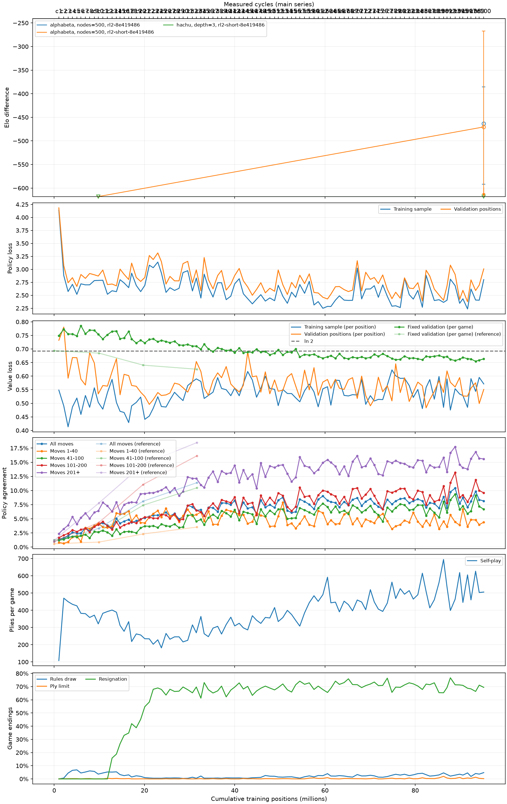

# 2回目の強化学習の系列

## 系列の説明

本書は、中将棋エンジンminaseのAlphaZero型探索の強化学習のうち、2回目の実行の系列のページである。
AlphaZero型探索は、ニューラルネットワーク（以下、ネット）でモンテカルロ木探索（以下、MCTS）を導く探索であり、強化学習では、前のサイクルのネットによる自己対局と、そこでためた局面による学習を1サイクルとして繰り返す。
この系列は、20ブロック256チャネルのネットをシード20261116でランダムに初期化したサイクル0から始めた（[2回目の実行の設計書](../../plans/alphazero-rl-2.md)）。
学習の設定は、先行するエンジンの方法と値に揃えたものであり（[学習レシピを先行実装に揃える設計書](../../plans/archived/zero-recipe-precedents.md)）、[1回目の系列](../alphazero-rl-1/README.md)とは、ネットの大きさ、規則、自己対局の開始局面、1手のシミュレーション回数、1サイクルの学習でリプレイバッファから抽出する局面の数、および学習率の予定が違う。

自己対局と学習は、vast.aiで借りたRTX 4090を4枚積んだ機械で、実行器`minase_zero run-cycles`が行った。
自己対局の規則は、オンライン対局サイトlishogiの実装に近い規則セット`lishogi`である。
実行器の系列の名前（`--cycles-dir`の値）は`cycles-rl2-az`であり、系列の記録はネットワーク接続の記憶装置（NAS）の`/mnt/synology_nas/minase/alphazero/cycles-rl2-az.jsonl`、各サイクルのチェックポイントとネットは同じディレクトリの`cycles-rl2-az/cycle-<4桁のサイクルの番号>/train/`にある。

## 状態

2026年11月17日にサイクル100を終えた。
サイクル11〜100は、利用者の決定で、10サイクルごとの定例の測定と続行の承認を行わずに回した。
固定の相手との対局では、サイクル10と100で各8ペア（先後を入れ替えた2局を1ペアとして計16局）の短い対局を行い（[短い対局の記録](../../measurements/alphazero-rl-2/alphazero-rl-2-short-matches-c0010-c0100.md)）、サイクル100では1手500ノードのαβ探索と100ペア（200局）を指した。
1回目の系列と比べて伸びが遅いので、2026年11月17日から18日に、サイクル100のネットに同じリプレイバッファで学習を追加する実験を行った（[追加学習の記録](../../measurements/alphazero-rl-2/alphazero-rl-2-c100-extra-training.md)）。
サイクル100までの累計と同じ量の学習を追加したネットは、αβ探索に対するEloが約230上がった。
次は、この結果を踏まえて、サイクル101以降の学習の設定を判断する。

## 進捗図

## 読み取れること

1手500ノードのαβ探索に対して、サイクル100のネットは100ペアで得点率6.5%、Elo −463（95%信頼区間［−592, −386］）であった。
各8ペアの短い対局では、αβ探索に対してサイクル10が16局全敗（Elo −∞）、サイクル100が16局中1勝であり、深さ3の中将棋の外部エンジンHaChuには、どちらのサイクルも16局全敗であった。
1回目の系列を同じ相手と条件で測った基準のEloは、αβ探索に対してサイクル10が−576、サイクル32が+17であり、2回目のサイクル100は1回目のサイクル10前後の水準にある。
2回目の系列の対局には、1回目と別の測定条件の名前を付けたので、進捗図の強さのパネルには1回目の点を重ねていない。

サイクル100のネットに、それまでに学んだ局面の延べ数と同じ約9,043万局面の学習を同じリプレイバッファで追加すると、同じ開始局面でのαβ探索に対する得点率は6.5%から20.5%に、Eloは−463から−235に上がった。
新しい自己対局を作らずに強くなったので、この系列は作ったデータに比べて学習の量が足りなかったとみられる。
一方、追加学習したネットの、固定の検証用データでの価値の損失と一致率、および学習器の方策の損失は、追加の量に応じて良くならなかった。
この系列では、これらの値は強さの変化を捉えないことがあるので、強さの判断には対局を使う。

固定の検証用データ（lishogiの人間同士の棋譜811局）では、生成した局面の累計が同じ時点で比べると、2回目の系列は1回目の系列より遅れている。
生成した局面の累計が約2,000万の時点で、価値の損失は1回目のサイクル20が0.6405、2回目のサイクル20（1,916万局面）が0.7322であり、人間が指した手との一致率はそれぞれ8.10%と4.94%である。
2回目の一致率が1回目のサイクル20の8.10%に初めて届いたのは、累計が約4,000万局面のサイクル42（8.23%）であり、1回目の約2倍の局面を要した。
2回目の価値の損失は、サイクル10の0.7541から下がり、サイクル37で初めて五分の予測の0.693を下回って、サイクル50で0.6787、サイクル100で0.6634となったが、サイクル60以後は0.655〜0.68の間を上下しており、1回目のサイクル20の0.6405にはサイクル100まで一度も届いていない。
サイクル100の手数の帯ごとの一致率は、201手目以降が15.58%と最も高く、1〜40手目は4.41%であった。

自己対局のデータから分けた検証局面では、サイクル10以後、価値の損失が0.48〜0.69、方策の損失が2.37〜3.32の間を上下しており、サイクルを追って下がり続けてはいない。
自己対局のデータでの損失は、ネットが変わると教師となる対局の内容も変わるので、強さの推移の目安には使えない。

自己対局の1局の手数は、サイクル1の108手からサイクル2で470手に延び、サイクル30の216手まで縮んだ後、サイクル90の695手まで延びて、サイクル100は506手であった。
規則による引き分けの割合はサイクル30で0.4%まで下がった後、サイクル100で4.8%に増えた。
手数の上限に達した対局の割合は、どのサイクルも2%未満であった。
自己対局の投了の閾値の較正はサイクル13から働き始め、サイクル30以後は対局の6〜7割が投了で終わった。

## 測定の条件

| 測定条件の名前 | MCTSのコミット | 1手のシミュレーション回数 | 対局の規則 | 条件を定めた設計書 |
|---|---|---|---|---|
| `rl2-8e419486` | `8e419486` | 800 | αβ探索との対局は`lishogi` | [強さを測る固定の相手](../../plans/archived/mcts-fixed-opponents.md)、[2回目の実行](../../plans/alphazero-rl-2.md) |
| `rl2-short-8e419486` | `8e419486` | 800 | αβ探索との対局は`lishogi`、HaChuとの対局はHaChuの既定の設定に対応する`L1,L3,P0,P5,P6,R2,E1,E2` | [強さを測る固定の相手](../../plans/archived/mcts-fixed-opponents.md)、[2回目の実行](../../plans/alphazero-rl-2.md) |

`rl2-8e419486`は、相手と対局の条件を定例の測定と同じにした条件であり、ペア数は記録ごとに違う（サイクル100は100ペア）。
`rl2-short-8e419486`は、相手と対局の条件を定例の測定と同じにし、ペア数だけを各8ペアに減らした条件である。
`NnBatchSize`は16、推論はTensorRTのFP16、同時対局数は4である。

## 費用

サイクル1〜100の料金の累計は、vast.aiで借りたRTX 4090を4枚積んだ機械で55.07米ドルであった。
1サイクルの時間は、サイクル30〜100で中央値16.6分、最大19.0分であり、料金は1サイクル約0.53米ドルである。
追加学習の実験には、別に5.82米ドルかかった。
サイクル101以降を回すには、vast.aiの口座への入金が要る。

## 測定記録

| サイクル | 記録 |
|---|---|
| 1〜3 | [最初のセッション](../../measurements/alphazero-rl-2/alphazero-rl-2-first-session.md) |
| 10、100 | [固定の相手との短い対局](../../measurements/alphazero-rl-2/alphazero-rl-2-short-matches-c0010-c0100.md) |
| 100 | [サイクル100のネットの追加学習とαβ探索との100ペアの対局](../../measurements/alphazero-rl-2/alphazero-rl-2-c100-extra-training.md) |
